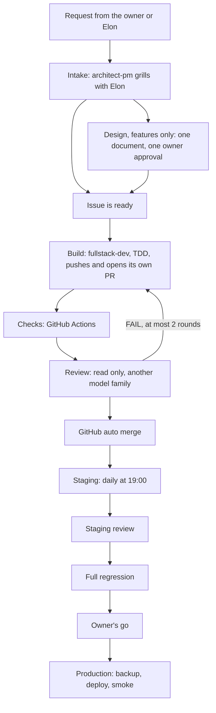

# Ming's Dotfiles and AI Agent Team

This repository does two jobs. It sets up a machine on macOS, Arch Linux or Debian. It also holds the basic guideline, tools and skills for an AI agent team that any project can adopt.

Each project uses what lives here as much as it can, and keeps only its own facts.

## 1. Set up a machine

```bash
mkdir -p ~/GitHub && cd ~/GitHub
git clone https://github.com/mingster/dotfiles.git && cd dotfiles
sh mac/osxprep.sh   # macOS only: installs Command Line Tools
sh install.sh
```

`install.sh` links `~/dotfiles`, your home configuration files and the shared skill folders, sets up editors, and runs the package script for your system (`mac/`, `arch/` or `debian/`). You can run it again safely. Unchanged tools are skipped and conflicting files are backed up.

| Command | Effect |
| --- | --- |
| `DOTFILES_SKIP_SYSTEM_SETUP=1 sh install.sh` | Refresh links without installing system packages |
| `DOTFILES_BREW_UPGRADE=1 sh install.sh` | Also upgrade Homebrew packages on macOS |
| `script/agent-team.sh machine` | Check agent tools on this machine (add `--dry-run` to preview) |

## 2. Adopt the team in a project

```bash
~/dotfiles/script/agent-team.sh project /path/to/project --project-name acme
```

This copies the roles and skills, sets up the issue tracker labels, writes the team skills into the project and runs an audit. Then fill in two files with the project's own facts:

* `docs/agents/team-facts.md`: repositories, stack and team facts.
* `docs/agents/deploy-facts.md`: deploy targets, URLs and smoke test commands.

## 3. The team guideline

### Goal

An agent team that follows the Matt Pocock and pstack skills and their design, in Orca ADE. A ticket goes from ready to merged with no agent relaying a message and no human in the loop. Main reaches staging every day by itself. Production needs a green staging review and the owner's go.

### Principles

* Use Orca, pstack and Matt Pocock skills as they are. Customize only when we must, and record why.
* Improve what exists before adding anything. Team rules and scripts must not grow in total.
* Each role takes the shortest path that still reaches the targets.
* When speed and quality conflict, quality wins for money, sign-in, database schema and hooks. Everything else takes the fast lane, and daily staging is the second line of defence.
* State lives only in GitHub and Orca. After a restart the team carries on from there.

### Targets

| Measure | Target |
| --- | --- |
| Start to merge, median | 60 minutes or less |
| Checks fail on first pass | 15% or less |
| Reopened or hotfix | 2% or less |
| P0 reaching production | 0 per month |
| Ready to worker start | 15 minutes |
| Build | 40 minutes |
| Checks | 10 minutes |
| Review | 10 minutes |
| Daily staging tests | 15 minutes |
| `heavy-gate` wait, median | 2 minutes or less |
| Worktrees on a host | Running workers plus a fixed list |

Missing data reads as unknown, never zero.

### Lifecycle

Each step is one run that does one job and ends. It never waits on a person or another agent. The next run reads GitHub.



| Step | Starts when | Who | Done when |
| --- | --- | --- | --- |
| Intake | A request arrives | architect-pm with Elon. Sales joins for UI or wording, support for support matters | Issue is ready, or closed as a duplicate |
| Design | Intake says it is a feature | Same people, with `capture-intent`, grill, spec and tickets | One document, one owner approval |
| Build | The 5 minute run finds a ready issue that passes the gates | fullstack-dev | PR open, pushed by the worker |
| Checks | Push to a PR | GitHub Actions | `head-checks` status posted |
| Review | Checks pass | Review script, read only | `review` status and one comment |
| Rework | Review fails | A fresh worker on the same branch | Builder answers in one comment |
| Merge | Both statuses pass | GitHub auto merge | PR merged |
| Wrap-up | A worker ends, or a PR merges or closes | Orca automation on each host | All read back as gone |
| Staging | Daily at 19:00 Taiwan time | release-manager | Latest main is on staging |
| Staging review | Staging deploy finished | qa-sdet | Green or red recorded |
| Full regression | Staging review all green | Machine, for every production deployment | Pass tells the owner. Fail opens an issue |
| Production | Owner's go | release-manager | Smoke passes, or code rolls back |

**Who can send a request.** The owner and Elon. Sales and support send requests to Elon, and Elon gets the owner's approval before passing one to architect-pm.

**Start rule.** An issue starts when it has `ready-for-agent`, acceptance criteria and no blocker, and the usage and load gates pass. `P0` and `P1` go first, then first in, first out.

**Failure.** A worker with no progress for 30 minutes restarts once. The same error fixed 3 times stops the work. Review sends a PR back at most 2 times. Past any limit a label goes to Elon.

**Wrap-up.** A finished worker loses its terminal and worktree. A merged or closed PR loses its branches and anything left. Work that exists nowhere else is kept and listed for Elon.

**Deploy safety.** Schema changes stay backward compatible. Production always backs up first, and a failed backup stops the deploy. If smoke fails, code rolls back by itself, and the database waits for the owner.

### Roles

| Role | Job |
| --- | --- |
| Owner | Decides the items listed under Owner decisions |
| Elon | The owner's window and only contact. Off the main line: the lifecycle runs without it. Answers "what now" and "recap", handles exceptions, sets priorities weekly |
| `architect-pm` | Intake, the design document, the weekly list, full audits |
| `fullstack-dev` | Builds one ticket with tests by TDD |
| `qa-sdet` | Playwright runs and the staging review |
| `release-manager` | Staging on schedule, production on the owner's go |
| `secops-finops` | Its check is part of Strong review. Weekly reconciliation |
| `sales-marketing` | Joins the grill for UI and wording. Sends requests to Elon |
| `support-csm` | Joins the grill for support matters. Sends requests to Elon. Replies go out only after the owner approves |

### Owner decisions

New features and pages, prices and money rules, production go, irreversible data changes, budget and legal commitments, paid usage overage, the weekly update PRs, and role file and hook changes. Nothing else interrupts the owner.

### Review

A builder never reviews its own PR. Review answers three questions: does the diff meet each acceptance line, is there a real bug, would the new test go red without the fix. Style is never a FAIL.

Standard depth is one read. Strong depth adds a stronger model and the security check for money, sign-in, schema, hooks and workflows. A script picks the depth from the file list. Changes only to docs and changelog pass with no agent.

Review replaces QA only after a replay of 30 defect heads and 30 clean heads shows at least 80% caught and at most 10% false FAILs.

## 4. Tools

These are the only team tools we keep or build. Full contracts live in each project's process spec.

| Tool | Job | Runs |
| --- | --- | --- |
| Orca automation | Starts every scheduled script. A script only job uses a precheck, so it spends no AI quota | On schedule |
| [`fleet-watch.py`](script/fleet-watch.py) | The 5 minute run: copies usage readings, reruns failed workflows once, finds stuck workers, checks backups, starts ready issues | Every 5 minutes on the coordinator |
| [`usage-gate.py`](script/usage-gate.py) | Blocks a worker start at 95% of a weekly limit or with no fresh reading. Paid overage needs the owner's approval with an amount and an expiry | Every worker start |
| [`heavy-gate.py`](script/heavy-gate.py) | Holds heavy jobs while a host is over its limit, and logs each wait | Every heavy job |
| `worker-startup` | Brings a host and worktree up to date, then starts the worker. A host that cannot be fixed takes no work | Daily, and before each worker |
| [`head-checks.sh`](script/head-checks.sh) | Runs a repository's checks on a trial merge of one head with main | Every PR push |
| Review | The three question review above. Posts the `review` status | After Checks pass |
| GitHub auto merge | Merges when `head-checks` and `review` pass | Every PR |
| [`wrap-up.sh`](script/wrap-up.sh) | Clears finished work. Never deletes the last copy. Add `--apply` to run it by hand | Every 10 minutes on every host |
| `/deploy` | Moves a commit to staging or production | Daily, or on the owner's go |
| `/staging-review` | Smoke, tests for what changed, changed pages on phone size. Every page weekly | After each staging deploy |
| Test selection | Compares with the last green staging commit and follows real imports | Every staging review |
| Weekly update | Matt Pocock and pstack upstream, bun and Node. Three tested PRs and one summary, merged only on the owner's yes | Weekly |
| [`team-audit.sh`](script/team-audit.sh) | Checks team files and reports the target numbers | Weekly one line result, full audit on the owner's word |
| `/elon status` | "what now": waiting on the owner, running, problems. "recap": merged, deployed, problems and numbers | Only on request |
| Agent state backup | Private repository with memory, schedules and host config, used to rebuild the coordinator | Every 10 minutes |

Project hooks stay small: a command guard for production, secrets and destructive commands, the three strike stop and the worker turn limit.

## 5. Engineering workflow

For a change in one repository, use the skills in order.

| Stage | Skill | What it does |
| --- | --- | --- |
| Intent | `/capture-intent` | The problem and outcome in the owner's words. New features only |
| Grill | `/grill-with-docs` | Interview that finds edge cases and records decisions |
| Spec | `/write-spec` or `/to-spec` | The agreed plan, no second interview |
| Tickets | `/to-tickets` | Small vertical slices with test cases |
| Build | `/implement` or `/tdd` | Red, green, refactor |
| Review | `/code-review` | Standards and spec, never skipped |

Shortcuts: a typo or config tweak goes straight to `/tdd` or an edit. A bug starts with `/diagnosing-bugs` until a test goes red. A single slice skips `/to-tickets`.

## 6. Shared skills

All skills live in `.agents/skills/<name>/`, and `install.sh` links them into Claude Code, Cursor and Antigravity. Change one here and every tool gets it.

* **Planning:** `capture-intent`, `grill-me`, `grilling`, `grill-with-docs`, `write-spec`, `to-spec`, `to-tickets`, `wayfinder`, `triage`, `domain-modeling`, `codebase-design`.
* **Building:** `tdd`, `implement`, `code-review`, `diagnosing-bugs`, `prototype`, `improve-codebase-architecture`, `resolving-merge-conflicts`, `laravel-inertia-react-structure`, `create-pr`.
* **Research and docs:** `research`, `retro`, `handoff`, `writing-for-agents`.
* **Environment:** `setup-matt-pocock-skills`, `agent-browser`, `orca-team`, `wizard`. Orca's own skills come from `orca skills install --all`.

## 7. Repository layout

| Path | Purpose |
| --- | --- |
| `install.sh` | Bootstrap for all systems |
| `mac/`, `arch/`, `debian/` | System packages and installers |
| `script/` | Setup scripts and team tools |
| `.agents/skills/` | Shared skills |
| `.agents/claude/` | Global Claude Code configuration |
| `templates/agent-team/` | Roles and team skills adopted into projects |
| `.config/` | Application configuration, managed with GNU Stow |
| `ide/` | Editor settings |
| `docs/agents/` | Deeper docs: [setup](docs/agents/agent-team-setup.md), [roles](docs/agents/team-reference.md), [settings backup](docs/agents/agent-settings-backup.md) |
