[繁體中文](README.zh-TW.md)

# Dotfiles and AI agent team

## What this is

This repository does two things:

1. **Sets up a computer for software work.** One command installs the tools, settings and editor setup on macOS, Arch Linux or Debian.
2. **Runs a team of AI agents.** It holds the roles, rules, scripts and skills that let a small team of AI agents build and ship software for any project, with a person stepping in only for the decisions that matter.

## Who it is for

* **Newcomers** who want to know what this repo does before reading code.
* **Project owners** who want AI agents to take care of the day to day building, testing and releasing.
* **Developers** who want the same machine setup on every computer.

## The agent team in everyday words

Think of a small software company where every employee is an AI agent:

* **The owner** (a person) sets direction and makes the few calls only a person should make, such as prices or going live.
* **The coordinator** acts like a manager. It reads the to do list, hands out work and answers questions, so the owner is not interrupted.
* **Builders** each take one task, work on their own copy of the code so they never get in each other's way, and hand back a finished change.
* **Reviewers** check every change. A reviewer always uses a different AI model from the one that wrote the change, so no one grades their own work.
* **Release and test roles** put the newest version on a test site every day and check it the way a user would.

The agents run inside [Orca](https://github.com/stablyai/orca), a desktop app that starts them, shows them side by side and lets them message each other. Work is tracked as GitHub issues and pull requests.

## Goal

An agent team, run inside Orca, that follows the [Matt Pocock](https://github.com/mattpocock/skills) and [pstack](https://github.com/cursor/plugins/tree/main/pstack) skills and their design. Each role does its job by the shortest path, with the highest chance of success and as few bugs as possible.

* **Orca first:** Orca starts every agent and runs every schedule. One 5 minute Orca job (fleet watch) starts builders, reviewers and fixers. GitHub Actions runs only the automatic checks and one cold code review.
* **Skills first:** the Matt Pocock and pstack skills are the base process, used as they are. The team changes them only when it must, and records why.
* **Measured results:** half of all tasks go from start to merge in 60 minutes or less, checks fail on the first try 15% of the time or less, 2% or less of merged changes are reopened or need a hotfix, and no top priority (P0) bug reaches production in a month. A weekly audit measures these numbers.
* **Independent review:** no role reviews its own work. Every change gets a cold review and a pass or fail from a reviewer of a different AI model family. (A one week trial, ending 2026-12-01, lets small changes to only docs or tests merge on the cold review alone, with a weekly spot check.)
* **AI usage gate:** every way of starting an agent passes one gate, which refuses when a provider is near its weekly limit. With no recent reading it refuses (Antigravity is the one exception). When a provider runs out, the work moves to the next one (Claude, then Antigravity, then Grok) on the same branch. Limits on how busy each computer may get still apply.
* **Wrap-up:** when a change merges, its agent stops, its copy of the code and its branches are deleted, and its terminals close. A cleanup runs once a day at 04:00 on every computer to catch anything missed. Unmerged work is never deleted.
* **Daily staging:** every day at 19:00 Taiwan time, when the test site is behind, the newest version goes to the test site (staging). Automatic tests and a check of the changed pages at phone size run right after. Every page gets checked once a week.
* **Production:** a change reaches the live site only after staging tests pass. While the live site holds only test data, a full regression run must pass first. Once a real store is live, nothing goes to production without the owner's go. Production always takes a backup first.
* **Owner's time:** the owner decides only money rules and prices, spending and contracts, customer messages, deleting data for good, going to production once a real store is live, and one look at a new feature or page. The coordinator decides the rest and writes the decision down.

## How one task flows

```mermaid
flowchart LR
    Issue["Issue: what done means"] --> Start["Coordinator starts one builder"]
    Start --> Build["Builder writes and tests the change"]
    Build --> PR["Pull request"]
    PR --> Check["Automatic checks and cold review"]
    Check --> Verdict["Reviewer from another model family"]
    Verdict --> Merge["Merge and clean up"]
    Merge --> Staging["Daily test site run"]
    Staging --> Prod["Production after the gates"]
```



1. Someone writes an issue that says what "done" looks like.
2. The coordinator starts one builder on it, in its own copy of the code.
3. The builder makes the change, tests it and opens a pull request.
4. Automatic checks and a cold review run. Then a reviewer from a different model family gives a pass or fail.
5. On a pass, the change merges and the builder cleans up after itself.
6. Each evening the newest version goes to the test site and gets tested. Production follows once the gates above are met.

## Get started

Set up a Mac (Arch Linux and Debian work the same way):

```bash
mkdir -p ~/GitHub && cd ~/GitHub
git clone https://github.com/mingster/dotfiles.git && cd dotfiles
sh mac/osxprep.sh   # macOS only: installs Command Line Tools
sh install.sh
```

`install.sh` is safe to run again. It skips what is already installed and backs up any file it would replace.

To give a project its own agent team, run `script/agent-team.sh project /path/to/project --project-name <name>`. The [technical overview](docs/technical-overview.md#adopt-the-team-in-a-project) walks through the rest.

## Read more

* [Technical overview](docs/technical-overview.md): setup options, fleet and load, team files, tools, engineering workflow, shared skills and the repository layout.
* [Agent team reference](docs/agents/team-reference.md): every role, rule, target and tool in full.
* [Coordinator operations](docs/agents/coordinator-operations.md) and [Agent team architecture](docs/agents/agent-team-architecture.md): how the coordinator runs the team.
* [RELEASE-NOTES.md](RELEASE-NOTES.md): what changed each week, in plain language.
* [CHANGELOG.md](CHANGELOG.md): the full technical list of changes.
