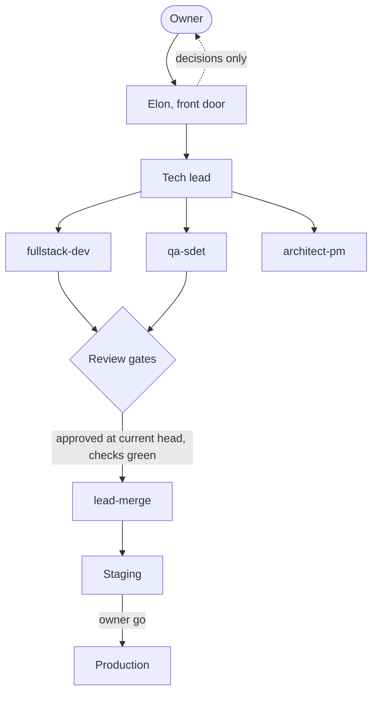
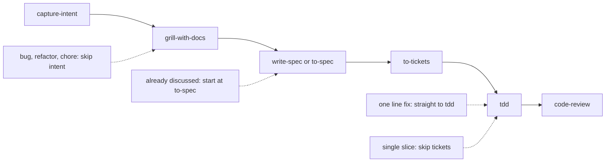

# Ming's dotfiles

One repo that sets up a Mac, Arch or Debian machine, wires the same AI skills into Claude Code, Codex, Cursor and Antigravity, and ships a small agent team you can drop into any project.

It is for you if you want a new machine ready in a few commands, or you want an AI "company" (a front door called Elon, a tech lead, and specialist workers) that plans, builds, reviews and ships your project while you only make the calls that are yours.

What you get:

* A machine that is set up the same way every time. `install.sh` is safe to re-run.
* About 30 shared skills (slash commands) for planning, test first coding and review.
* An agent team template: roles, skills, hooks and rules you adopt into a project.

## Quick start

```bash
mkdir -p ~/GitHub && cd ~/GitHub
git clone https://github.com/mingster/dotfiles.git && cd dotfiles
sh mac/osxprep.sh   # macOS only: Command Line Tools
sh install.sh
```

`install.sh` links `~/dotfiles` to this repo, links shell and git dotfiles into `$HOME`, creates real home skill directories, sets up the AI tooling, then runs the OS installer (`mac/`, `arch/` or `debian/` `system_setup.sh`). Already installed software is skipped.

| Flag | Effect |
| --- | --- |
| `DOTFILES_SKIP_SYSTEM_SETUP=1 sh install.sh` | Only refresh links, install no software |
| `DOTFILES_BREW_UPGRADE=1 sh install.sh` | Also run `brew upgrade` on macOS |

How the skills reach each tool:


## Use the agent team in a project

You talk to one person, Elon. He plans, hands work to a lead, and the lead runs workers. You are asked only for decisions that are yours: money, production deploys, contracts, accepting an intent or spec.



Set it up once per project:

```bash
~/dotfiles/script/adopt-agent-team.sh --project-name acme ~/projects/acme   # roles, skills, hooks, routing
~/dotfiles/script/init-agent-project.sh --labels ~/projects/acme            # tracker, labels, domain docs
```

Then fill in `docs/agents/team-facts.md` and `deploy-facts.md` in the project. `script/agent-team.sh` handles machine setup and safe reset previews. Details, backups and owner steps: [Agent team setup](docs/agents/agent-team-setup.md).

What you do day to day (slash commands work in Claude Code, Cursor and Antigravity; in Codex write `$skill-name`):

| You want to | Say |
| --- | --- |
| Start or pick the next objective | `/elon Help me choose the next objective.` |
| Get status | `/elon status` (Now, Needs owner, Running) or `/tl status` |
| Deliver a batch of tickets | `/elon Deliver the ready setup tickets using /crew and /tdd.` |
| Clear decisions blocking the queue | `/grill-backlog` |
| Promote a release | `/deploy staging`, then `/deploy production` |
| Run the daily checklist | `/elon daily run` |
| Check the team files for drift | `/team-audit` |

Owner approvals and protected files:

* The lead merges reviewed PRs through `script/lead-merge.sh` only, never with `--admin`. Workers commit on their own branch and never push or merge.
* Owner only files stay out of the lead's merges: `.claude/hooks/`, `.claude/settings.json`, `bin/owner-approve.sh` (in each project), `.codex`, `*.rules`, and intents that become Accepted.
* Accepting an intent or spec, every production deploy and every migration go to you.
* You allow the merge script once, by appending `templates/codex/lead-merge.rules` to `~/.codex/rules/default.rules`. Agents never edit `~/.codex`.

Roles, project files and the full command table per stage: [Agent team reference](docs/agents/team-reference.md). Design: [Agent team architecture](docs/agents/agent-team-architecture.md).

## Engineering workflow

The default path for any feature, refactor or bug that is not trivial. Name the stage you are in.



| Stage | Skill | What happens |
| --- | --- | --- |
| Intent | `/capture-intent` | The problem and wanted outcome, in your words, until you accept it. New features only. |
| Grill | `/grill-with-docs` | One question at a time until the design fits the codebase. Writes ADRs and a glossary. |
| Spec | `/write-spec` or `/to-spec` | `spec.md` next to the intent, or a spec on the issue tracker. No second interview. |
| Tickets | `/to-tickets` | Small vertical slices with blocking edges, each sized for a fresh context. |
| Build | `/tdd` | One failing test, then the least code that passes it. |
| Review | `/code-review` | The diff against repo standards and against the spec. Never skipped. |

Each repo needs its tracker config first. Run `~/dotfiles/script/init-agent-project.sh --labels` in the repo root (add `--dry-run` to preview). Use `setup-matt-pocock-skills` instead for a monorepo or a non GitHub tracker.

## Skills catalog

Everything below lives in `.agents/skills/<name>/`. Team skills (`elon`, `crew`, `tl`, `deploy`, `wrap-up` and others) come from `templates/agent-team/.agents/skills/`. Full inventory: [skills inventory](docs/agents/skills-inventory.md).

**Plan and spec**

* `capture-intent`: turn an idea or incident into an `intent.md`.
* `grill-me`, `grilling`, `grill-with-docs`: stress test a plan, optionally recording docs.
* `write-spec`, `to-spec`: write the spec from an intent or from the conversation.
* `to-tickets`: split a spec into tracer bullet tickets.
* `wayfinder`: map work too big for one session as decision tickets.
* `triage`: move issues through the triage labels.
* `domain-modeling`, `codebase-design`: sharpen terms, ADRs and module boundaries.

**Build and review**

* `tdd`: red, green, refactor.
* `implement`: build from a spec or tickets.
* `code-review`: standards and spec review in parallel.
* `diagnosing-bugs`: loop for hard bugs and slow code.
* `prototype`: throwaway code to answer a design question.
* `improve-codebase-architecture`: find deepening opportunities, report as HTML.
* `resolving-merge-conflicts`: finish a merge or rebase.
* `laravel-inertia-react-structure`: frontend layout for Laravel Inertia React.
* `create-pr`: commit, check and publish a PR.

**Research and notes**

* `research`: gather primary source facts into a Markdown file.
* `retro`: retrospective on a coding session.
* `handoff`: compact a conversation for another agent.
* `writing-for-agents`: rules for writing skills and `AGENTS.md`.

**Tools and setup**

* `setup-matt-pocock-skills`: configure a repo's tracker, labels and domain docs.
* `agent-browser`: drive a browser for tests, forms and screenshots.
* `computer-use`: drive a visible desktop app window.
* `orca-cli`, `orca-team`, `orca-per-workspace-env`: operate Orca worktrees, worker panes and per workspace environments.
* `wizard`: a bash wizard for steps only a human can do.

## Model routing and usage gate

Strong models take ambiguous decisions, specs, security and money review. Workhorse models take building, QA, release and support. Before every `worker-start`, `usage-gate.py check` reads real provider usage and blocks only at the 95% weekly ceiling. Rules live in the project's `.claude/model-routing.md`. More: [architecture, section on models and usage](docs/agents/agent-team-architecture.md) and [ADR 0001](docs/adr/0001-shared-team-skills-and-usage-caps.md).

## Maintenance

| Task | Command |
| --- | --- |
| Clean finished branches, worktrees and ended panes | `/wrap-up`, or `script/wrap-up.sh --repo "$PWD"` (dry run; add `--apply`) |
| Clean up after a merge | `script/merge-cleanup.sh --branch <pr head> [--issue N] [--pr N]` (`DRY_RUN=1` previews) |
| Regenerate project team skills from the template | `script/sync-team-skills.sh` (`--check` fails on drift). Edit the template, never the generated copies. |
| Audit team files | `/team-audit` or `script/team-audit.sh` |
| Find shadowed or broken skills | `script/check-skill-collisions.sh` |
| Migrate legacy skill links | `bash script/setup-agent-skills.sh` |
| Add a lesson to the shared notes | `~/dotfiles/script/contribute-to-agents.sh nextjs "Nested route-group layouts cause dev 404s"` |
| Back up app settings | `bash script/backup-claude-desktop.sh`, `fish script/backup-tide.fish` |

A project skill with the same name as a central one silently wins, so keep reusable skills here only and project skills in `<project>/.agents/skills/`. Sharing rules and the notes tiers: [Agent team reference](docs/agents/team-reference.md).

## Machine setup per OS

| OS | Installer | Notes |
| --- | --- | --- |
| macOS | `mac/system_setup.sh` | Run `mac/osxprep.sh` first. `mac/stowall` stows app configs. |
| Arch | `arch/system_setup.sh` | Chosen from `$OSTYPE` and `/etc/os-release`. |
| Debian | `debian/system_setup.sh` | Same detection. |

AI tooling scripts, all called from `install.sh`:

| Script | Sets up |
| --- | --- |
| `script/setup-claude-code.sh` | `~/.claude/` from `.agents/claude/`, skills at `~/.claude/skills/` |
| `script/setup-claude-desktop.sh` | Claude Desktop config |
| `script/setup-cursor.sh`, `link-cursor-user.sh` | Cursor app, rules, settings, hooks, and `~/.cursor/skills` |
| `script/setup-antigravity.sh` | Antigravity settings and `~/.gemini/config/skills.json` |
| `script/setup-vscode.sh` | VS Code settings |
| `script/setup-obsidian.sh` | Obsidian vault at `~/Documents/Obsidian`, synced with MEGAcmd |

MCP secrets go in `~/.claude/settings.local.json` (gitignored). Path map and boundaries: [AGENTS.md](AGENTS.md).

| Path | Role |
| --- | --- |
| `install.sh` | Single entry point |
| `mac/` `arch/` `debian/` | Platform installers |
| `script/` | Setup, backup and agent team scripts |
| `.agents/` | Skills and Claude Code config (`claude/`) |
| `templates/agent-team/` | The agent team template |
| `.config/`, `ide/cursor/`, `vscode/`, `Antigravity/` | App and editor configs |
