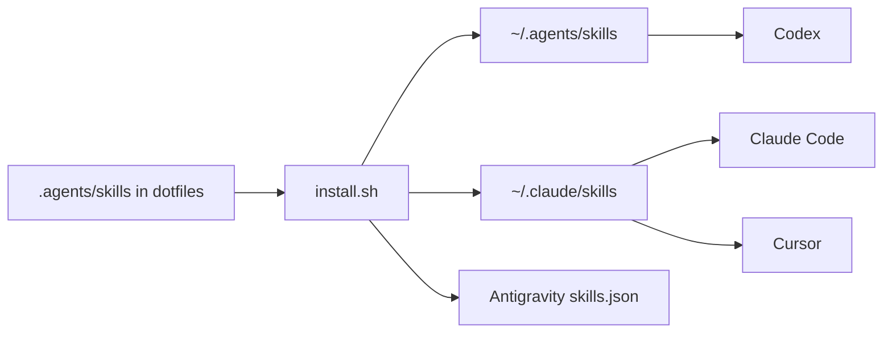
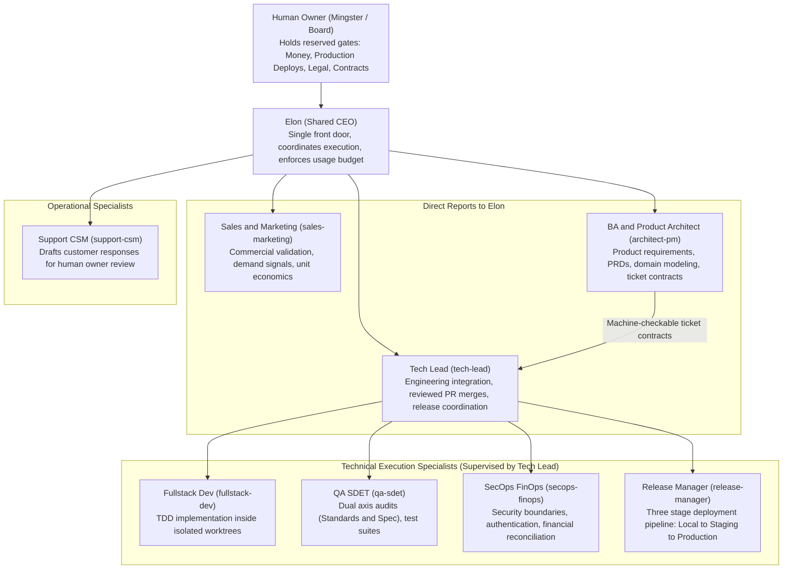
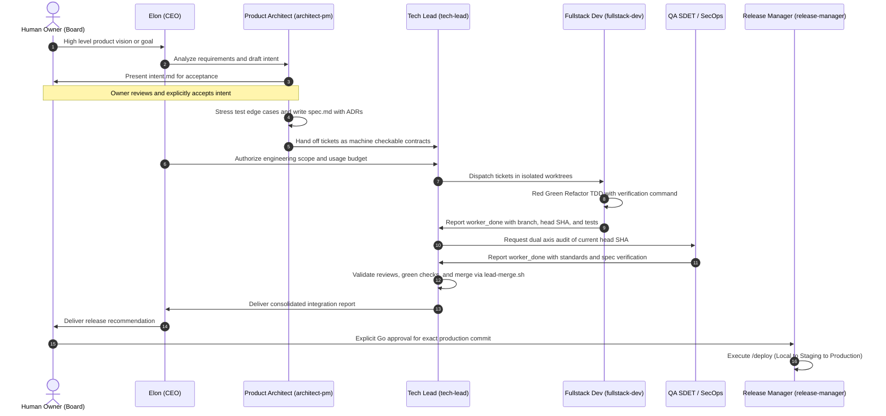
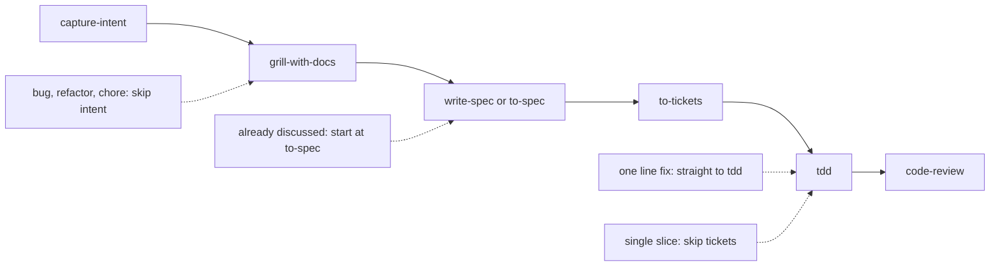

# Ming's Dotfiles and AI Agent Organization

Welcome to Ming's dotfiles. This repository serves two purposes. First, it automates machine setup across macOS, Arch Linux, and Debian, configuring shells, tools, and developer environments. Second, it equips modern AI coding assistants (Claude Code, Codex, Cursor, and Antigravity) with a shared library of engineering skills and an autonomous agent team ready to adopt into any software project.

## 1. Overview for Newcomers

If you are new to this repository, here is what it provides and how the pieces connect.

### What is this repository?

This repository contains everything needed to turn a fresh operating system installation into a fully configured developer workstation, paired with an AI engineering organization.

* **Unified system configuration:** Installs core developer tooling, the Zsh shell, Git configuration, and application preferences across macOS, Arch Linux, and Debian.
* **Universal AI skills:** Supplies over 30 reusable engineering skills (slash commands) shared uniformly across Claude Code, Codex, Cursor, and Antigravity.
* **Autonomous AI agent team:** Packages a drop in virtual software company led by a single executive front door (Elon), backed by a Product Architect, a Tech Lead, and specialist execution workers.

### Core philosophy

* **Idempotent and safe:** Running `install.sh` multiple times will never destroy existing data. Unmodified tools are skipped, and existing conflicting configurations are backed up.
* **Separation of concerns:** You remain the human owner and board member. You retain full control over financial commitments, production deployments, legal agreements, and contract acceptance. Routine implementation, testing, review, and staging operations are delegated to agents.
* **Single source of truth:** Central skills live in `.agents/skills/`. When you update a skill here, every supported AI tool immediately shares the improvement.

### How skills reach your AI tools



## 2. Quick Start Guide

### Step 1: Bootstrap the machine

Clone the repository and run the installation script:

```bash
mkdir -p ~/GitHub && cd ~/GitHub
git clone https://github.com/mingster/dotfiles.git && cd dotfiles
sh mac/osxprep.sh   # macOS only: installs Command Line Tools
sh install.sh
```

`install.sh` creates a symlink at `~/dotfiles`, links your home configuration files, connects the shared AI skill folders, configures editor settings, and delegates package installation to your platform script (`mac/`, `arch/`, or `debian/`).

#### Useful installer flags

| Command | Effect |
| --- | --- |
| `DOTFILES_SKIP_SYSTEM_SETUP=1 sh install.sh` | Refreshes configuration symlinks without installing operating system packages |
| `DOTFILES_BREW_UPGRADE=1 sh install.sh` | Upgrades installed Homebrew packages on macOS during installation |

#### Verifying AI provider tools

To verify provider CLIs and machine readiness for agent teams, run:

```bash
script/agent-team.sh machine
```

Add `--dry-run` to preview checks without applying changes.

### Step 2: Adopt the agent team in a project

To equip any repository with the full autonomous agent team, run the unified setup command:

```bash
~/dotfiles/script/agent-team.sh project /path/to/project --project-name acme
```

This automated command executes four tasks:

1. Copies team roles, skills, and routing rules into the project.
2. Initializes tracker configuration and creates GitHub triage labels (`init-agent-project.sh --labels`).
3. Generates committed copies of team skills (`sync-team-skills.sh`).
4. Runs an audit to verify configuration consistency (`team-audit.sh`).

#### Complete project facts

After adoption, open the project and fill in two documentation files:

* `docs/agents/team-facts.md`: Specific project context, team roster, repository urls, and tech stack details.
* `docs/agents/deploy-facts.md`: Deployment targets, environment urls, and automated smoke test commands.

#### Authorize Tech Lead merges (one time setup)

Codex workers are blocked from executing `gh pr merge` directly. The Tech Lead merges exclusively through the verified `script/lead-merge.sh` utility. Allow this command once by appending the rules template to your local Codex rules:

```bash
sed "s|__HOME__|$HOME|g" ~/dotfiles/templates/codex/lead-merge.rules >> ~/.codex/rules/default.rules
```

Agents never modify `~/.codex` themselves, guaranteeing that unverified merges remain blocked.

## 3. The Agent Team Organization

The agent team functions like an agile software organization. You interact with a single executive point of contact, Elon. Teammates coordinate through Orca orchestration in isolated worktrees, reporting progress back up the hierarchy.

### Organization chart



### Roles and responsibilities

* **Human Owner (Board):** You hold the ultimate keys. Only you can authorize production deployments, approve permanent pricing changes, sign contracts, and accept new product intents or specifications.
* **Elon (CEO):** Your direct peer and single front door. Dispatches teammates using Orca orchestration, monitors delivery progress, runs usage gates, and contacts you only when an Owner Reserved decision is reached.
* **Sales and Marketing (`sales-marketing`):** Evaluates user acquisition channels, customer lifetime value, churn metrics, and market demand before software is built.
* **BA and Product Architect (`architect-pm`):** Translates ideas into clear specifications (`intent.md` and `spec.md`). Breaks specifications into machine checkable GitHub issue tickets containing strict file allowlists and test criteria.
* **Tech Lead (`tech-lead`):** Supervises engineering workers, opens pull requests, validates risk reviews, and merges pull requests via `script/lead-merge.sh`.
* **Fullstack Dev (`fullstack-dev`):** Implements code strictly through test-driven development inside isolated Git worktrees. Only touches allowlisted files.
* **QA SDET (`qa-sdet`):** Performs rigorous dual axis reviews on the pull request head commit (Standards conformity and Spec adherence).
* **SecOps and FinOps (`secops-finops`):** Audits security, token access boundaries, multi-tenant isolation, and billing calculations.
* **Release Manager (`release-manager`):** Manages release promotions across Local, Staging, and Production environments following human approval.
* **Support CSM (`support-csm`):** Drafts responses to customer issues for owner approval before anything is sent.

## 4. Designated Workflow

Every major feature, refactor, or bug fix follows a structured lifecycle to eliminate regressions and maintain auditability.

### End to end delivery lifecycle



### Engineering stages and skills

For day to day engineering tasks, follow the standard six stage cycle:



| Stage | Skill | What happens |
| --- | --- | --- |
| 1. Intent | `/capture-intent` | Captures the problem and desired outcome in your words. Produces an `intent.md` file for human acceptance. Required for new features. |
| 2. Grill | `/grill-with-docs` | Conducts a structured interview one question at a time to uncover edge cases and document Architectural Decision Records (ADRs). |
| 3. Spec | `/write-spec` or `/to-spec` | Synthesizes the agreed plan into a definitive `spec.md` or tracker specification. No second interview required. |
| 4. Tickets | `/to-tickets` | Decomposes the specification into small, testable vertical slices with explicit file allowlists and test gates. |
| 5. Build | `/tdd` | Executes strict test driven development (write failing test, write minimal passing code, refactor). |
| 6. Review | `/code-review` | Audits the pull request along two parallel axes: Repo Standards and Spec Adherence. Never skipped. |

#### Workflow escape hatches

For smaller tasks, you can bypass early stages, but Stage 6 (Review) is never skipped:

* **One line fix, typo, or configuration tweak:** Proceed straight to `/tdd`, or directly edit if behavior is unchanged.
* **Bug fix:** Run `/diagnosing-bugs` until a test reproduces the failure, then resolve using `/tdd`.
* **Previously discussed task:** Begin directly at `/to-spec`.
* **Single slice requiring no decomposition:** Skip `/to-tickets` and build directly with `/tdd`.

## 5. Day to Day Operations

Slash commands work in Claude Code, Cursor, and Antigravity. In OpenAI Codex, invoke skills by prefixing with a dollar sign (for example, `$elon`).

### Common commands

| Goal | Command | Description |
| --- | --- | --- |
| Start or plan next objective | `/elon Help me choose the next objective.` | Elon reviews backlog and recommends priorities |
| Check project status | `/elon status` or `/teddy status` | Returns concise status categorized into Now, Needs Owner, and Running |
| Deliver a batch of tickets | `/elon Deliver ready tickets using /crew and /tdd.` | Hands scoped tickets to Tech Lead for worker dispatch |
| Unblock decision backlog | `/grill-backlog` | Walks through unresolved tickets to clear decisions |
| Deploy to Staging | `/deploy staging` | Promotes verified main branch to staging environment |
| Deploy to Production | `/deploy production` | Requests owner approval, then deploys to production |
| Run daily health checklist | `/elon daily run` | Runs automated team health and project checks |
| Audit team configuration | `/team-audit` | Checks for drift between project team files and dotfiles |
| Clean completed worktrees | `/wrap-up` | Prunes merged branches, clean worktrees, and ended panes |

### Model routing and usage gate

To optimize cost and performance, tasks are routed based on complexity:

* **Frontier models (such as Claude 3.7 Sonnet or Claude Opus):** Reserved for ambiguous decisions, architecture specifications, security reviews, and financial reconciliation.
* **Workhorse models:** Assigned to focused implementation, unit test writing, and bug reproduction.
* **Usage gate safety:** Before any worker process starts, `usage-gate.py` checks provider consumption. Worker dispatch is automatically paused if the 95% weekly token budget ceiling is reached.

## 6. Shared Skills Catalog

All skills live in `.agents/skills/<name>/` and are automatically linked into your tools.

* **Planning and specification:** `capture-intent`, `grill-me`, `grilling`, `grill-with-docs`, `write-spec`, `to-spec`, `to-tickets`, `wayfinder`, `triage`, `domain-modeling`, `codebase-design`.
* **Implementation and testing:** `tdd`, `implement`, `code-review`, `diagnosing-bugs`, `prototype`, `improve-codebase-architecture`, `resolving-merge-conflicts`, `laravel-inertia-react-structure`, `create-pr`.
* **Research and documentation:** `research`, `retro`, `handoff`, `writing-for-agents`.
* **Tooling and environment control:** `setup-matt-pocock-skills`, `agent-browser`, `orca-team`, `wizard` (Orca's own skills such as `orca-cli` and `computer-use` come from `orca skills install --all`).

## 7. Maintenance and Housekeeping

Keep your machine and project environments tidy with these maintenance scripts:

| Task | Command |
| --- | --- |
| Preview and prune finished branches and worktrees | `script/wrap-up.sh --repo "$PWD"` (add `--apply` to execute) |
| Clean up worktrees after pull request merge | `script/merge-cleanup.sh --branch <branch-name> [--issue N] [--pr N]` |
| Sync project team skills with updated templates | `script/sync-team-skills.sh` (use `--check` to detect drift) |
| Reset project team files to fresh template state | `script/agent-team.sh reset /path/to/project` (add `--apply` to execute) |
| Detect shadowed or colliding skill names | `script/check-skill-collisions.sh` |
| Share reusable knowledge across all projects | `~/dotfiles/script/contribute-to-agents.sh <topic> "Insight learned"` |

## 8. Repository Layout

| Directory or File | Purpose |
| --- | --- |
| `install.sh` | Main bootstrap script for all operating systems |
| `mac/`, `arch/`, `debian/` | Operating system packages and system installers |
| `script/` | Setup scripts, maintenance tools, and agent team automation |
| `.agents/skills/` | Central catalog of shared agent skills |
| `.agents/claude/` | Global Claude Code configuration, prompts, and notes |
| `templates/agent-team/` | Template files and roles adopted into projects |
| `.config/` | Application configurations managed via GNU Stow |
| `ide/` | Settings and keybindings for Cursor, VS Code, and Antigravity |
| `docs/agents/` | Deep documentation covering team architecture, setup, and skills |

## 9. Agent Team Key Features

A short tour of the parts that keep the agent team safe and tidy, for a reader who has never seen it.

### AI usage gate

[`script/usage-gate.py`](script/usage-gate.py) decides whether a provider may take another worker. It reads real usage from each provider (Codex, Claude, Cursor and Antigravity each have their own source), never a guess. A reading older than 5 minutes is refreshed. If no fresh reading can be had, the answer is "unknown", and unknown does not block a start.

* **Weekly limit:** a provider is blocked once it reaches the weekly ceiling (95% by default). Each running worker also holds back 1 percentage point of headroom.
* **Daily pacing:** a daily cap is only a hint. Past it, the worker is still allowed, with a note to prefer a lighter model.
* **Tight provider:** when one provider is tight, the `pick` command ranks providers by remaining weekly headroom, so work moves to the one with the most room.

### Resource guardrails

Agent settings backup and restore coverage is documented in
[`docs/agents/agent-settings-backup.md`](docs/agents/agent-settings-backup.md).
Run `bash script/setup-check.sh --agent-settings-only` to find settings missing
from public templates or the external private backup manifest.

Heavy jobs (type checks, test suites, browser runs) share one machine budget so parallel workers do not freeze it.

* [`script/heavy-gate.sh`](script/heavy-gate.sh) and [`script/heavy-gate.py`](script/heavy-gate.py) hand out heavy job slots. A job waits while the load is above the limit or free memory is under 20%. A job started with `HEAVY_GATE_CLASS=long` (a full regression run or long build) leaves one slot free for short scoped test jobs. See [cleanup and inspect-only recovery](docs/heavy-gate.md).
* [`script/head-checks.sh`](script/head-checks.sh) runs a repository's checklist in a clean worktree at one exact commit, and holds the gate for the whole run.
* [`script/hw-probe.sh`](script/hw-probe.sh) inspects the hardware. When run at a quiet time with a workload command, it calibrates the slot count and load limit for this machine and writes them to `~/.config/heavy-gate/slots.conf`. Without that file, the defaults are 2 slots and a load limit of 12.
* [`script/remote-heavy.sh`](script/remote-heavy.sh) sends the current commit to a `<remote host>`, runs a heavy command there under that host's gate, and can fetch artifacts back.

### Roles and templates

The team's role files and skills live once in [`templates/agent-team/`](templates/agent-team/). [`script/sync-team-skills.sh`](script/sync-team-skills.sh) writes them into each project as committed copies, and `--check` fails when a project has drifted. The roles and their duties are listed in [`docs/agents/team-reference.md`](docs/agents/team-reference.md). Adoption steps are in [`docs/agents/agent-team-setup.md`](docs/agents/agent-team-setup.md).

### Worker lifecycle

* **Start:** the coordinator dispatches a worker with `orca orchestration worker-start`. The worker gets its own worktree.
* **Panes and titles:** [`orca-team`](.agents/skills/orca-team/SKILL.md) shows each worker in a pane whose title bar color comes from the role in the task title, using [`role-colors.tsv`](.agents/skills/orca-team/role-colors.tsv).
* **Watching:** [`script/worker-watchdog.sh`](script/worker-watchdog.sh) nudges an idle worker and escalates to the owning coordinator if it stays idle or a report goes unread. It never stops or retries a worker.
* **Finish:** [`script/worker-finish.sh`](script/worker-finish.sh) runs the head checks, then releases the dispatch, closes the pane and removes the worktree.
* **Wrap up:** [`script/wrap-up.sh`](script/wrap-up.sh) previews and prunes finished branches and worktrees (add `--apply` to execute).

### Team audit

[`script/team-audit.sh`](script/team-audit.sh) runs fixed checks on the team files, such as sync with the templates, role file length, banned wording and the shape of ready tickets. It exits 0 when clean and 1 on any finding. The `team-audit` skill adds a judgement pass. It reads the observation log, a private file at `~/.claude/state/team-observations.md` where Elon notes problems as work happens, and turns them into lasting fixes such as a check or a role rule. That log stays private and is never copied into a repository.
