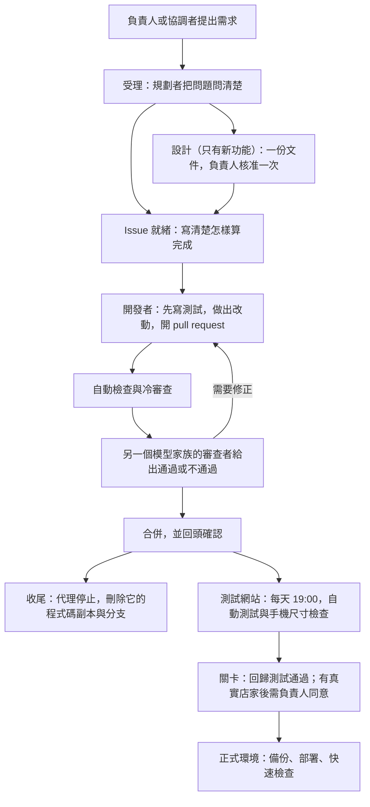

[English](README.md)

# Dotfiles 與 AI 代理團隊

## 這是什麼

這個儲存庫做兩件事：

1. **幫電腦裝好寫軟體需要的一切。** 一個指令就能在 macOS、Arch Linux 或 Debian 上安裝工具、設定和編輯器。
2. **運作一支 AI 代理團隊。** 這裡放著角色、規則、腳本和技能，讓一小群 AI 代理替任何專案開發並發布軟體，只有重要的決定才需要人來做。

## 適合誰看

* **新來的人**：想先知道這個儲存庫在做什麼，再去看程式碼。
* **專案負責人**：想讓 AI 代理處理日常的開發、測試和發布。
* **開發者**：想在每台電腦上都有一樣的環境。

## 用日常語言說明代理團隊

想像一間小軟體公司，每位員工都是 AI 代理：

* **負責人**（一個真人）決定方向，只做必須由人來做的決定，例如價格或正式上線。
* **協調者**像經理。它讀待辦清單、分派工作、回答問題，讓負責人不被打擾。
* **開發者代理**每次只接一個任務，在自己的程式碼副本上工作，彼此不會互相干擾，完成後交回一份改動。
* **審查者**檢查每一份改動。審查者一定使用和作者不同的 AI 模型，所以沒有人替自己的作業打分數。
* **發布與測試角色**每天把最新版本放到測試網站，並像使用者一樣實際檢查。

代理都在 [Orca](https://github.com/stablyai/orca) 裡執行。Orca 是一個桌面應用程式，負責啟動代理、把它們並排顯示，並讓它們互相傳訊息。工作以 GitHub 的 issue 和 pull request 追蹤。

## 目標

一支在 Orca 裡運作的代理團隊，遵循 [Matt Pocock](https://github.com/mattpocock/skills) 和 [pstack](https://github.com/cursor/plugins/tree/main/pstack) 的技能與設計。每個角色都用最短的路完成工作，成功率最高、錯誤最少。

* **Orca 優先：** Orca 啟動每一個代理，也執行每一個排程。一個每 5 分鐘執行的 Orca 工作（fleet watch）負責啟動開發者、審查者和修正者。GitHub Actions 只執行自動檢查和一次冷審查（cold review）。
* **技能優先：** Matt Pocock 和 pstack 的技能是基本流程，原樣使用。團隊只在必要時修改，並記錄原因。
* **用數字衡量：** 一半的任務從開始到合併在 60 分鐘以內，第一次檢查失敗的比例在 15% 以下，合併後被重開或需要緊急修正的改動在 2% 以下，每個月沒有最高優先（P0）的錯誤進到正式環境。每週的稽核會量測這些數字。
* **獨立審查：** 沒有角色審查自己的工作。每份改動都有一次冷審查，以及一位不同 AI 模型家族的審查者給出通過或不通過。（一個到 2026-12-01 結束、為期一週的試行，讓只改文件或測試的小改動可以只靠冷審查合併，並每週抽查。）
* **AI 用量閘門：** 每一種啟動代理的方式都要通過同一個閘門，當某家供應商接近每週上限時就拒絕。沒有近期的用量讀數時也會拒絕（Antigravity 是唯一的例外）。某家供應商用完時，工作會在同一個分支上交給下一家（Claude，接著 Antigravity，再來是 Grok）。每台電腦的負載上限照樣有效。
* **收尾：** 改動合併後，它的代理會停止，程式碼副本和分支會被刪除，終端機會關閉。每台電腦每天 04:00 會做一次清理，補上漏掉的部分。尚未合併的工作永遠不會被刪除。
* **每日測試站：** 每天台灣時間 19:00，如果測試網站落後，最新版本就會放上測試網站（staging）。接著馬上執行自動測試，並用手機尺寸檢查有改動的頁面。每個頁面每週都會檢查一次。
* **正式環境：** 改動要等測試網站的測試通過，才會進到正式網站。在正式網站只有測試資料的期間，必須先通過完整的回歸測試。一旦真正的商店上線，沒有負責人同意，任何東西都不會進到正式環境。正式環境每次都會先備份。
* **負責人的時間：** 負責人只決定金錢規則和價格、支出和合約、給客戶的訊息、永久刪除資料、真正的商店上線後的正式部署，以及新功能或新頁面上線前看一眼。其他的都由協調者決定並記錄下來。

### 目標數字

| 量測項目 | 目標 |
| --- | --- |
| 從開始到合併（中位數） | 60 分鐘以內 |
| 第一次檢查就失敗 | 15% 以下 |
| 合併後重開或緊急修正 | 2% 以下 |
| P0 錯誤進到正式環境 | 每月 0 件 |
| 任務就緒到開始動工 | 15 分鐘 |
| 實作 | 40 分鐘 |
| 自動檢查 | 10 分鐘 |
| 審查 | 10 分鐘 |
| 每日 staging 測試 | 15 分鐘 |

沒有資料時記為「未知」，絕不記為零。

## 一個任務怎麼跑完



1. 有人開一個 issue，寫清楚怎樣算「完成」。
2. 協調者派一位開發者處理，它在自己的程式碼副本上工作。
3. 開發者做出改動、測試，然後開一個 pull request。
4. 自動檢查和冷審查先執行，接著由不同模型家族的審查者給出通過或不通過。
5. 通過後改動合併，開發者自己清理收尾。
6. 每天晚上最新版本會放上測試網站並接受測試。符合上面的關卡後才會進正式環境。

## 開始使用

在 Mac 上安裝（Arch Linux 和 Debian 的做法一樣）：

```bash
mkdir -p ~/GitHub && cd ~/GitHub
git clone https://github.com/mingster/dotfiles.git && cd dotfiles
sh mac/osxprep.sh   # 只有 macOS 需要：安裝 Command Line Tools
sh install.sh
```

`install.sh` 可以安全地重複執行。已經裝好的會跳過，要被取代的檔案會先備份。

要讓一個專案擁有自己的代理團隊，執行 `script/agent-team.sh project /path/to/project --project-name <name>`。其餘步驟請看[技術概覽](docs/technical-overview.md#adopt-the-team-in-a-project)（英文）。

## 延伸閱讀

* [技術概覽](docs/technical-overview.md)：安裝選項、機群與負載、團隊檔案、工具、工程流程、共用技能和儲存庫結構。
* [代理團隊參考](docs/agents/team-reference.md)：每個角色、規則、目標和工具的完整說明。
* [協調者運作](docs/agents/coordinator-operations.md)和[代理團隊架構](docs/agents/agent-team-architecture.md)：協調者如何帶領團隊。
* [RELEASE-NOTES.md](RELEASE-NOTES.md)：每週的改動，用白話寫成。
* [CHANGELOG.md](CHANGELOG.md)：完整的技術改動清單。

以上連結的文件目前只有英文版。
