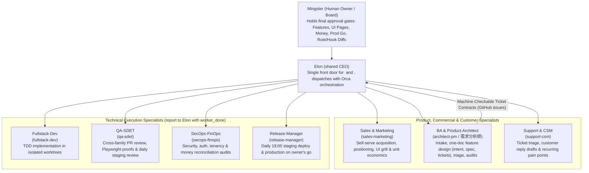
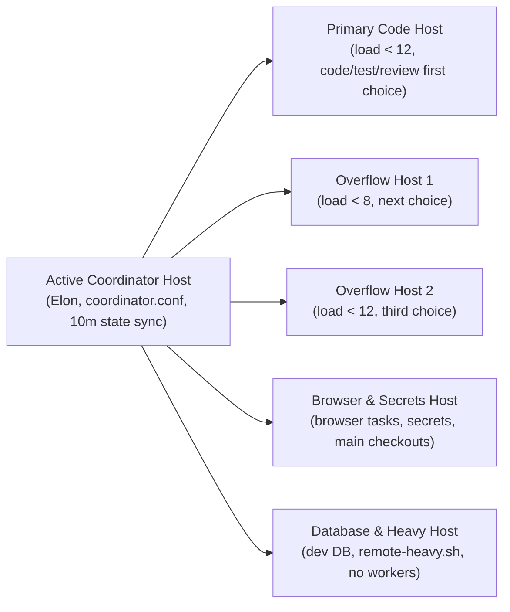

# Agent team architecture

Overview of the AI agent team across **<project-a>**, **<project-b>** and future adoptions. The current rules live in the root [README](../../README.md), each project's `docs/agents/team.md` and `.claude/model-routing.md`; when this file disagrees with them, they win.

## 1. Organization

Mingster talks only to **The coordinator (`elon`)**, the shared CEO and single front door of <project-a> and <project-b>. The coordinator delegates to teammates, every teammate reports to the coordinator, and the coordinator reports to Mingster. Each project has eight shared roles (the coordinator and seven specialists); a project may add its own roles in its `.claude/agents/`.



## 2. Responsibilities and decision boundaries

- **Mingster (user / board).** Talks to the coordinator (`/elon` or `/ceo`) as executive peer. Decides only money rules and prices, spending and contracts, sending customer replies, irreversible data deletion, production deploy once a real store is live, and a look at each new feature or page before production (owner grill 2026-11-13 gap 8). Nothing else interrupts the user.
- **The coordinator.** Critical, program driven partner without flattery. The user's window and only contact, off the main line (`README.md` section 3). Turns vision into commercial experiments (Sales), requirements (BA) and delivery (workers), sets priorities weekly, handles `needs-elon` exceptions, dispatches ready issues within `usage-gate.py` and `heavy-gate.py`, and contacts the user only for a user decision. Never uses Claude subagents. Commands: `/elon <goal>` or `/ceo <goal>`. Unprompted messages carry a decision, options, a recommendation and any exact command; routine progress, merges, reviews and staging deploys are not reported. On `/elon status` ("what now") the format is **Now**, **Needs user**, **Running**; on "recap" it reports merged, deployed, problems and numbers.
- **Sales and Marketing (`sales-marketing`).** Owns self-serve acquisition, positioning, conversion experiments and metric definitions (MRR, LTV, CAC, churn, 14 day activation), and joins the pre-build grill for new UI pages and wording. Delegates market research, competitor price comparison and Taiwan merchant lookups to a Gemini worker on Antigravity (requiring a source URL for every number and merchant fact, spot-checked before use). Never plans manual outbound sales, sends unapproved emails, touches production tables or alters live pricing.
- **BA (`architect-pm` / 需求分析師).** Runs intake, writes one design document per feature (intent, spec and units with one user approval), slices specs into machine-checkable GitHub issues with `to-tickets`, maintains the weekly list of non-blocker findings, and runs full `/team-audit` reviews on the user's word. Never writes application code.
- **Support tickets (`support-csm`, user rule 2026-10-12).** When a ticket or support email arrives, the underlying problem is resolved first when it needs a fix, `support-csm` drafts the reply in the customer's language, and the coordinator notifies Mingster the same day with the ticket, what was done and the draft. Nothing is sent or closed before the user approves.

## 3. Delivery lifecycle

GitHub issues and PRs are the state of record (`README.md` section 3). After each push, GitHub Actions `Checks` run first; when they pass, Actions `Review` (`script/pr-review.sh`) and the verifier (`qa-sdet` via `script/post-verdict.sh`) run. The 5 minute babysit pass (`fleet-watch.py`) starts one verifier when head-checks passed and the head has no Verdict. The existing fix worker and a Shipping run (`script/ship.sh`) still run for a failing head and for a passing Verdict that matches the head. `wrap-up.sh` cleans up every 10 minutes. Docs and changelog only PRs pass with no agent.

```mermaid
sequenceDiagram
    autonumber
    actor Owner as Owner
    participant CEO as Elon (CEO)
    participant BA as architect-pm / sales-marketing
    participant Dev as Fullstack-Dev
    participant QA as Actions Review & QA-SDET Verifier
    participant Ship as Shipping Run (script/ship.sh)
    participant RM as Release-Manager

    Owner->>CEO: Product Vision / Feature Goal
    CEO->>BA: Intake, pre-build grill (money or new UI page), one design doc (intent, spec, tickets)
    BA->>Owner: One approval for new feature, new UI page (with phone screenshots), price or money rule
    BA->>CEO: Ready GitHub issue tickets (Machine-checkable contracts)

    CEO->>Dev: 5 minute run starts scoped ticket in isolated worktree
    Dev->>Dev: Bug fixes start with a failing test, features, scripts and refactors require tests and proof on the real artifact (refactors prove behavior unchanged), local checks, push once and open PR
    Dev->>QA: Actions Checks pass; Actions Review (pr-review.sh) and verifier Verdict (post-verdict.sh)
    QA->>Ship: 5 minute babysit pass starts a verifier; a fix worker or a Shipping run still runs for the other groups
    Ship->>Ship: Squash merge (gh pr merge --squash), read back as MERGED; 10m wrap-up cleans worktree

    RM->>RM: Daily 19:00 Taiwan time staging deploy
    RM->>QA: swarm staging review (full regression, smoke, changed pages on phone viewport; all pages weekly)
    CEO->>Owner: One-line staging summary for same-day production Go
    Owner->>RM: Explicit Owner Go for exact production SHA
    RM->>RM: Production backup, deploy and live smoke check (auto code rollback on smoke fail)
```

## 4. Unit and review contracts

Each ready GitHub issue carries in one text (body or a single comment) these three fields:

1. **`## Acceptance criteria`:** observable cases, allowed files, and the exact proving command (the unit's listed test cases from the spec's `## Test plan` plus touched unit tests, never the full regression suite).
2. **`Requirement owner:`** the requester and reason (per The Algorithm: question the requirement first).
3. **`Deleted:`** what requirement or step was removed, or `nothing, because ...`.

Pre-build grill gate (user rule 2026-11-06): a multi-role grill runs only for **money** (payments, billing, refunds, ledger, credits, pricing or entitlements) with `secops-finops`, `architect-pm` and the coordinator, and for **new UI pages** with `sales-marketing` and the coordinator. The user approves the result before build. All other work has no grill: the coordinator decides and records it on the issue. Exact user-facing copy in `tw`, `en` (fluent American English, written natively) and `jp` (natural Japanese, written natively) is approved at the spec.

Every code change passes `script/head-checks.sh` once per head and an independent cross-family review before merge. The verifier never runs unit tests, `tsc` or lint; it reads the diff and the `head-checks.sh` Checks receipt, proves load-bearing behaviour live (browser at phone viewport for UI, real API call or script run), answers the three review questions (does the diff meet each acceptance line, is there a real bug, would the new test go red without the fix), and posts `Verdict: PASS|PASS+NOTES|FAIL head=<full sha> verifier=<dispatch id> author=<dispatch id>` with `Command: <exact test command run>`. Extra Strong (Claude Opus) cross review is required only for money transactions or when the coordinator or the user explicitly requests it on the issue or PR. A PASS Verdict and Checks PASS carry across a clean merge of `main` (`verdict_carry`).

## 5. Persistent memory (`active_run.md`)

A worker on a unit with more than one slice keeps one git-ignored ledger, `active_run.md`, in its worktree root, so a compaction or restart restores state in one turn. It is written once before code changes (program, allowed files, verification command, steps) and updated only when blocked or at a handoff (strike count, `[Blockers]`). It does not replace the coordinator's child ledger (`docs/agents/team.md`, rule Child ledger).

Template and examples: [Persistent memory protocol](persistent-memory-protocol.md).

## 6. Token efficiency and FinOps

1. **Model and effort:** pick the tier by task (Strong for ambiguous decisions, specs, security or financial review; Workhorse for implementation, coordination, QA, release, sales and support; Light for clerical subtasks and `fullstack-dev-small` fixes touching 3 files or fewer). Flags: `.claude/model-routing.md`.
2. **Usage gate (fail closed, user 2026-11-06, reworked 2026-11-13):** every provider (`claude`, `cursor`, `antigravity`) and every way of starting a worker passes `script/usage-gate.py` and `script/usage-gate-hook.py`. The hook denies any `worker-start` when usage plus the running-worker reserve (2 points per strong model, 1 per other) reaches the provider's ceiling in `script/usage-gate.config.json` (Claude 95, Cursor included pool 100, each Antigravity pool 95; exit 3), when no fresh reading is available and the last good reading is over 2 hours old or within 10 points of the ceiling (exit 4; Antigravity is the exception: `check` and `pick` both allow it with a note and the worker stops at its first quota or sign-in error), when `--agent` is missing or unknown, or when `--on` is called directly instead of through `script/start-remote-worker.sh`, `script/start-cursor-worker.sh` or `script/worker-startup.sh`. The daily cap blocks automatic starts only (`--auto`, passed by fleet-watch for the issue scan and babysit); a manual or coordinator start past it gets a note. `fleet-watch.py` logs every refusal and tells the coordinator once after 30 minutes of refusals with over 20 points of headroom. `usage-gate.py show` prints sources, ages and reset times. Decision record: `docs/adr/0001-shared-team-skills-and-usage-caps.md`.
3. **Heavy gate:** Playwright and production builds run through `~/dotfiles/script/heavy-gate.sh --weight 2` (at most 2 per host). Full `tsc` uses `--measure` without a slot. Unit tests and lint skip the gate. Wait in the foreground under the tool timeout, never via background shell polling.
4. **Strikes and Attack the Premise:** at the second failure of the same check, write down and directly test the shared premise before a third attempt. Three behavioural failures of the same command after production edits trigger a hard stop (`.claude/hooks/strikes.py`); tooling or setup failures (missing dependencies, Prisma generation, typegen) do not count toward the three strikes.
5. **On demand memory:** never load `learned.md` or `experiences/` at session start; grep them only when a domain gotcha comes up.
6. **Worktrees and worktree cleanup:** child worktrees go in `~/orca/workspaces/<project>/<lane>`, never `/tmp` or `.claude/worktrees`. When a job merges or settles, release the worker with `worker-pane-close.sh --release <dispatch_id>` and let `script/wrap-up.sh` prune finished branches, worktrees, terminals and temp browsers.
7. **Team audit:** Orca runs `script/team-audit.sh` and `script/team-audit-metrics.ts` weekly for a one-line result. When the user says "team-audit", `architect-pm` runs the full `/team-audit` skill: six deterministic checks (sync, 800-word role budget, banned wording, skills, ready-for-agent label conflicts, and `Owner-approved:` role commit trailers), mistake classes found by `workflow-from-chats` over the last 7 days of transcripts and the observation log `~/agent-state/team-observations.tsv`, each fixed through `/correct`, the Orca stage times, and the five delivery metrics (`median_ticket_start_to_merge_minutes`, `first_pass_checks_fail_rate`, `p0_filed_this_month`, `p1_filed_this_month`, `reopened_or_hotfix_rate`).
8. **Context hygiene:** one unit per session (a worker exits once its branch is committed, verified and reported). Keep `active_run.md` current on multi-slice work so `/compact` loses no state. The coordinator delegates heavy reading and test sweeps to Orca workers and reads only diff stats and exit codes.

## 7. Fleet and load distribution

The team operates across a fleet of Macs paired in Orca ADE (`orca environment list`) so PR owners, verifiers and heavy check jobs run in parallel without overloading a single machine.



### Coordinator authority and fleet synchronization

- **Single active coordinator:** `agent-state/coordinator.conf` names one `coordinator <host>` and ordered `backup <host>` entries. `script/elon-startup.sh` verifies that the current host matches `coordinator.conf` and `.sync-ok` is under 30 minutes old before any dispatch.
- **State and checkout sync:** the active coordinator pushes state every 10 minutes (`sync.sh push`), while backup hosts run `script/fleet-watch.py` (`coordinator_watch`) to alert if the coordinator goes unreachable or stale. `script/fleet-pull.sh` fast-forwards clean `main` checkouts across fleet hosts (for hosts in `agent_hosts`, resets configured repositories to `origin/main` and cleans untracked files while keeping ignored files and fast-forwarding `~/agent-state` only) and runs `script/secrets-sync.sh`. Before launching any worker, `script/worker-startup.sh` aligns `~/dotfiles`, `~/.orca/presets.json`, repo `main`, Node (`.tool-versions` via `asdf`) and Bun (`package.json`) on the target host.
- **Manual failover only:** failover is never automatic. On the user's instruction, `script/take-over-coordinator.sh --yes` fences the old host via `coordinator.conf`, restores state on the backup host, and starts the sync LaunchAgent there.

### Host placement and routing order

The coordinator picks the target host for each task using `~/.claude/state/fleet-load.sh`:

1. **Primary code host (also hosts the coordinator):** first choice for code, test and review while 1-minute load < 12.
2. **First overflow host:** next choice while 1-minute load < 8.
3. **Second overflow host:** next choice while 1-minute load < 12.
4. **Browser and secrets host:** always used for browser work, secrets and main-checkout operations.
5. **Release-manager host:** runs only on a host named in the project's `docs/agents/deploy-facts.md`.
6. **Database and heavy host:** hosts the dev database and runs remote Playwright or `head-checks.sh` jobs via `script/remote-heavy.sh`; never runs interactive agent workers.

### Worker admission and load balancing

- **Admission formula (user 2026-11-04):** admit a new worker on a host when `(1-minute load / CPU cores) < 0.7` and `free memory >= 4 GB`, within that host's worker cap (`host_caps`).
- **Load band target:** host caps are a ceiling, never a target. Fill an idle host up to its cap before any host with queued work waits, and aim to keep each active host between `0.4` and `0.7` load per core.
- **Counting active slots:** count PR owners, verifiers, child dispatches and finished committers still holding a pending-push slot.
- **Per-host heavy job admission (`script/heavy-gate.sh`):** Playwright and builds use weight 2 slots; full `tsc` uses measure mode. `script/fleet-watch.py` alerts when a host's 24-hour median slot wait exceeds 2 minutes.

Operational details: [Coordinator operations](coordinator-operations.md) and [Fleet watch](fleet-watch.md).

## 8. Providers in Orca ADE

Every provider is driven through Orca orchestration (`orca orchestration worker-start --agent <provider> --model <id> [--effort <level>]`) and reports with `worker_done` to the coordinator. Model names, presets and fallback chains live in `.claude/model-routing.md` and `~/.orca/presets.json`. General fallback order: **Claude, Cursor, Antigravity**, starting from each role's default provider:

- **The coordinator:** defaults to Claude Opus medium (`--agent claude --model opus --effort medium`), fallback Antigravity `gemini-4-argon-medium` (`--agent antigravity --model gemini-4-argon-medium`).
- **`fullstack-dev`:** runs on Cursor `grok-4.7-xhigh` first (user rule 2026-11-09), then Claude Sonnet medium (`--agent claude --model sonnet --effort medium`) when Cursor quota is out, then Antigravity `gemini-4-argon-medium` (with file-list and i18n-key audit before merge). When Argon stalls on a build or CLI deploy error, hand the same worktree to a Claude worker (`fullstack-dev-debug`).
- **`qa-sdet` (independent family review):** never uses the author's model family. A Claude author is reviewed by Antigravity `gemini-4-argon-high` or, when Argon is out, Cursor `grok-4.7-high` (user rule 2026-11-06). A Gemini or Cursor Grok author is reviewed by Claude. Cursor runs only `grok-4.7-xhigh` (or `grok-4.7-xhigh-fast` when urgent) to build and `grok-4.7-high` to review.
- **`sales-marketing`:** runs on Claude Sonnet medium for Traditional Chinese copy, positioning, pricing strategy and SQL analysis; delegates market research, competitor pricing and Taiwan merchant lookups to Antigravity `gemini-4-argon-high` (or the next provider passing the usage gate) with mandatory source URLs.
- **Other specialists (`architect-pm`, `secops-finops`, `release-manager`, `support-csm`):** default to Claude for their tier (Strong Opus high or Workhorse Sonnet medium), falling back per `.claude/model-routing.md`.

| Provider | Role loading | Notes |
| :--- | :--- | :--- |
| **Claude** | Role files in `.claude/agents/*.md` | `model:` and `effort:` in role frontmatter apply only under `claude --agent <role>`. Hooks in `.claude/settings.json` run automatically. |
| **Cursor** | Spec says read `<repo root>/.claude/agents/<role>.md` first, plus `.cursor/rules/` | Effort is in the model id (`grok-4.7-xhigh`, `grok-4.7-high`). Start via `script/start-cursor-worker.sh` (or `script/worker-startup.sh`) to pre-write `.workspace-trusted`. |
| **Antigravity** | Spec says read `<repo root>/.claude/agents/<role>.md` first, plus `AGENTS.md` and `.agents/skills/` | Effort is in the model id (`gemini-4-argon-high`, `gemini-4-argon-medium`, `gemini-3.8-flash`). Local host only until remote attach is supported. |

Sources of truth: `AGENTS.md` for conventions; `.claude/agents/` for role boundaries on every provider (every role change requires human user review and an `Owner-approved:` commit trailer). Skills come in three tiers: Tier 1 general skills from `~/dotfiles/.agents/skills/`, Tier 2 team skills from `~/dotfiles/templates/agent-team/.agents/skills/` linked on each machine by `script/setup-agent-skills.sh`, and Tier 3 project-specific skills. Details: [Skills inventory](skills-inventory.md).

## 9. Tools

Every repeatable team step is backed by a script under `script/`, `.agents/skills/orca-team/`, or `bin/`:

- **Setup, adoption and skill sync:** `agent-team.sh`, `adopt-agent-team.sh`, `init-agent-project.sh`, `agent-project-autoinit.sh`, `sync-mattpocock-skills.sh`, `check-skill-collisions.sh`, `bootstrap-asdf-tools.sh`, `bun-pin-check.sh`, `switch-login-shell-zsh.sh`, `agent-settings-check.py`, `backup-claude-desktop.sh`, `contribute-to-agents.sh`.
- **Coordinator, fleet and state sync:** `elon-startup.sh`, `new-coordinator.sh`, `take-over-coordinator.sh`, `orca-reply.sh`, `fleet-pull.sh`, `fleet-watch.py`, `fleet-workers.py`, `count-agents.sh`, `secrets-pack.sh`, `secrets-unpack.sh`, `secrets-sync.sh`.
- **Worker launch, usage gate and heavy gate:** `worker-startup.sh`, `start-remote-worker.sh`, `start-cursor-worker.sh`, `worktree-setup.sh`, `usage-gate.py`, `usage-gate-hook.py`, `heavy-gate.sh`, `heavy-gate.py`, `hw-probe.sh`, `remote-heavy.sh`, `run-scoped-tests.py`, and the `orca-team` helpers (`worker-start-check.sh`, `worker-watch.sh`, `worker-panes.sh`, `worker-pane.sh`, `worker-pane-close.sh`, `worker-pane-retry.sh`).
- **Checks, review and merge:** `coordinator-publication.sh`, `head-checks.sh`, `head-checks-tsc.sh`, `pr-review.sh`, `post-verdict.sh`, `ship.sh`.
- **Cleanup, audits and weekly maintenance:** `wrap-up.sh`, `worktree-idle.py`, `team-audit.sh`, `script/team-audit-metrics.ts`, `weekly-update.sh`, `prepend-recent-change.ts`, `shellcheck-dotfiles.sh`.

Full per-tool reference table: [Agent team reference](team-reference.md).

## 10. Shared and per project

The generic source is `~/dotfiles/templates/agent-team/`. Each project holds filled-in copies (`docs/agents/team.md`, `docs/agents/team-facts.md`, `docs/agents/deploy-facts.md`, `.claude/agents/`, `.claude/model-routing.md`), and its agents follow those. Team skills are not copied into a project: edit `templates/agent-team/.agents/skills/`, and machines read them through links from `script/setup-agent-skills.sh`. `agent-team.sh sync <project>` removes any older copy, and `agent-team.sh check` reports one as drift. `script/weekly-update.sh` keeps upstream Matt Pocock skills, pstack skills, Bun and Node LTS pins current across three tested PRs for user review.
