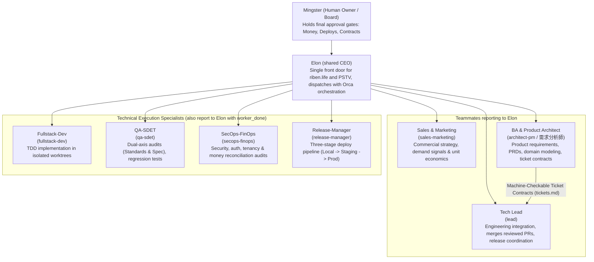
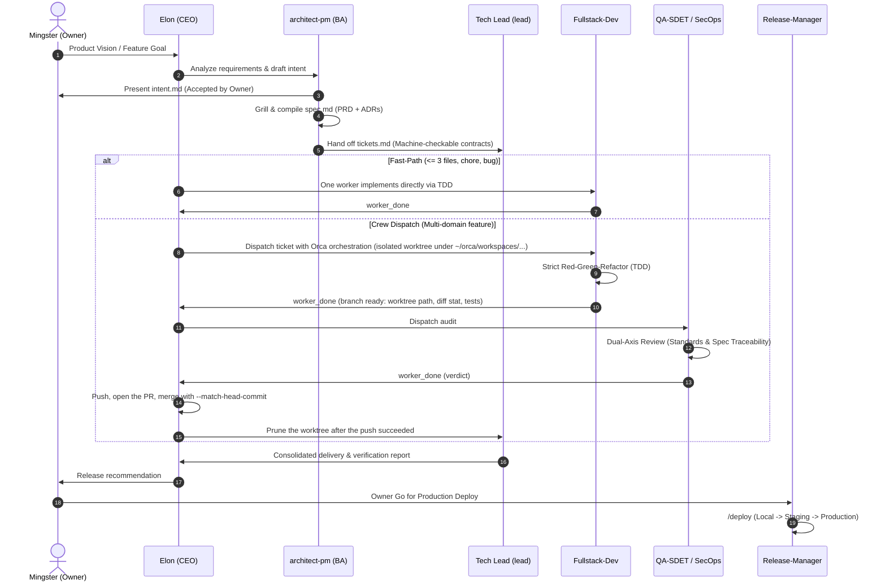

# Agent team architecture

Overview of the AI agent team across **riben.life**, **PSTV** and future adoptions. The current rules live in each project's `docs/agents/team.md` and `.claude/model-routing.md`; when this file disagrees with them, they win.

## 1. Organization

Mingster talks only to **Elon (`elon`)**, the shared CEO and single front door of riben.life and PSTV. Elon delegates to teammates, every teammate reports to Elon, and Elon reports to Mingster. riben.life has nine roles (Elon, the Tech Lead `lead`, seven specialists); PSTV has ten (plus `stream-health`).

Not drawn: `support-csm` (customer support and success) in both projects, and `stream-health` (streaming and infrastructure checks) in PSTV only. Each reports to Elon.

## 2. Responsibilities and decision boundaries

- **Mingster (board).** Talks to Elon (`/elon` or `/ceo`) as executive peer and sounding board. Keeps approval over permanent pricing, discounts and plan fees; irreversible production data migrations or schema drops; production deployments (go or no go); external spending and advertising.
- **Elon.** Critical, objective driven partner without flattery. Turns vision into commercial experiments (Sales), requirements (BA) and delivery (Tech Lead and workers). Plans, dispatches every teammate with Orca orchestration (skill `orchestration`, `orca orchestration worker-start`, `check`, `worker-release`), collects each `worker_done`, and contacts Mingster only for an Owner-Reserved decision. Never uses Claude subagents or experimental agent teams. Runs the usage gate before every `worker-start`. Commands: `/elon <goal>` or `/ceo <goal>`. Unprompted messages carry a decision, options, a recommendation and any exact command; progress, merges, reviews and staging deploys are not reported. On request the format is **Now**, **Needs owner**, **Running**.
- **Sales and Marketing (`sales-marketing`).** Validates demand and acquisition channels (CAC, LTV, churn, activation) and supplies evidence based problem definitions. Never sends unapproved marketing email, touches production ledgers or offers unapproved discounts.
- **BA (`architect-pm` / 需求分析師).** Turns pain points and owner vision into `intent.md`, then `spec.md` (PRD), then machine checkable ticket contracts (`tickets.md`); works with the Tech Lead on handoffs. Never writes application code.
- **Tech Lead (`lead`).** Reports delivery status and capacity to Elon. Publishes and integrates reviewed branches, keeps branches and worktrees clean, coordinates releases, starts and supervises engineering workers in Orca with the same usage gate. Receives ticket contracts from the BA. *Merging:* the Tech Lead pushes branches, opens PRs and merges reviewed work ("Commit, push and merge" in `.claude/model-routing.md`); workers commit on their own branches and report; Elon owns priorities and owner decisions. Once required risk-based reviewers (including SecOps or stream-health where required) approve the current full head SHA, checks are green and the PR is mergeable, the lead merges at once, never with `--admin`. PRs accepting an intent or spec, every production deploy and migrations still go to the owner. Release-manager pushes only the staging and production branches.
- **Support tickets (owner rule 2026-10-12).** When a ticket or support email arrives: the problem is resolved first when it needs a fix, `support-csm` drafts the reply in the customer's language, and Elon notifies Mingster at once with the ticket, what was done and the draft. Nothing is sent before he approves. A ticket found in the daily run or a status check is reported the same day.

## 3. Delivery lifecycle

## 4. Ticket and review contracts

Each BA ticket (`tickets.md`) defines:

1. **Allowed files:** the exact files or folders the agent may touch. Any edit outside fails review.
2. **Verification command:** the deterministic test that gates the ticket (for example `bun test --isolate <path>`, `bun run lint`).
3. **Blast radius and reversibility:** impact (Low, Medium, High) and rollback notes.

Every code change passes two axes before merge. **Standards:** `AGENTS.md` conventions, safe actions only in `"use server"`, tenant and store scoping, BigInt epochs, Fowler smells. **Spec:** every acceptance criterion met, only allowlisted files touched, no scope creep.

## 5. Persistent memory (`active_run.md`)

A worker on a ticket with more than one slice keeps one git ignored ledger, `active_run.md`, in its worktree root, so a compaction or restart restores state in one turn. It is written before code changes (objective, allowed files, verification command, steps) and again only when blocked or at a handoff (strike count, `[Blockers]`).

Template and examples: `docs/agents/persistent-memory-protocol.md`.

## 6. Token efficiency and FinOps

1. **Model and effort:** pick the tier by task (Strong for ambiguous decisions, specs, security or financial review; Workhorse for implementation, coordination, QA, release, support). Flags: `.claude/model-routing.md`.
2. **Usage gate:** before every `worker-start`, `usage-gate.py check --provider <provider>` reads real provider usage; rules are in `.claude/model-routing.md` (Starting a worker). Only fresh weekly usage plus the running-worker reserve reaching the 95% ceiling blocks (Cursor uses its billing cycle; Antigravity uses model pools). Daily pacing is advisory. Missing, expired or older-than-five-minute readings trigger a provider refresh; failure reports `unknown` with the source and reason and allows work. `usage-gate.py show` prints sources, ages and reset times (`--json` for raw rows). `script/usage-gate-hook.py` enforces the ceiling for all four providers.
3. **Strikes:** one rule, in each project's `AGENTS.md` (Token budget), enforced by `.claude/hooks/strikes.py`; blockers go in `active_run.md` under `[Blockers]`.
4. **On demand memory:** never load `learned.md` or `experiences/` at session start; grep them when a known domain gotcha comes up.
5. **Worktrees:** child worktrees go in `~/orca/workspaces/<project>/<lane>`, never `/tmp` or `.claude/worktrees`. Remove them (`git worktree remove`) as soon as they are integrated or abandoned. Release each finished worker with `orca orchestration worker-release --dispatch <id>`, failed ones too.
6. **State artifacts:** `docs/agents/lean-startup-sdlc.md` defines the `active_run.md` format and zero env disclosure. Living specs stay in the project's SDLC intent or spec folders.
7. **Monthly team audit:** `/team-audit` runs `script/team-audit.sh` (sync check, role file budgets, banned wording, skill frontmatter, skill lock, orchestration helpers), then reviews role files, skills, `.claude/model-routing.md` and owner rules for contradictions and proposes edits on a branch.
8. **Context hygiene:** one ticket per session (a worker exits once its branch is committed, verified and reported; the Tech Lead publishes the reviewed branch under model-routing). Keep `active_run.md` current so an operator can `/compact` mid task. Elon and the Tech Lead hand heavy reading and test sweeps to Orca workers and read only diff stats and exit codes. Try speculative fixes in disposable worktrees or forked sessions and discard failures.

## 7. Providers in Orca ADE

Every provider is driven the same way, `orca orchestration worker-start --agent <provider> --model <id> --effort <level>`, and every worker sends `worker_done` to Elon. Model names and flags live only in each project's `.claude/model-routing.md`. Fallback order: **Claude, Codex, Cursor, Antigravity**. A provider is unavailable on quota exhaustion, a long rate limit, an auth error or an outage: rerun the task on the next one, never downgrade silently, finish a task where it landed and start the next on the preferred provider.

| Provider | Role loading | Notes |
| :--- | :--- | :--- |
| **Claude** | Role files in `.claude/agents/*.md` | Default for most roles. `model:` and `effort:` apply only under `claude --agent <role>`. |
| **Codex** | The spec says read `.claude/agents/<role>.md` first | No Claude hooks, so the strike rule in `AGENTS.md` is the guard. |
| **Cursor** | Same as Codex, plus `.cursor/rules/` | Effort is in the model id. New worktrees need workspace trust. |
| **Antigravity** | Same as Codex, plus project `AGENTS.md` and `.agents/skills/` | Effort is in the model id. |

Sources of truth: `AGENTS.md` for conventions; `.claude/agents/` for role boundaries on every provider. Skills come in three tiers. General skills (`orchestration`, `to-tickets`, `create-pr`, `tdd` and the rest) come only from dotfiles through `~/.claude/skills` and `~/.agents/skills`. Team skills (`elon`, `ceo`, `crew`, `tl`, `deploy`, `team-audit`) are committed generated copies in each project's `.agents/skills/`, written by `~/dotfiles/script/sync-team-skills.sh`, reading product facts from `docs/agents/team-facts.md` and `docs/agents/deploy-facts.md`. Project only skills stay in the project. Details: `docs/agents/skills-inventory.md`.

## 8. Shared and per project

The generic source is `~/dotfiles/templates/agent-team/`. Each project holds filled in copies (`docs/agents/team.md`, `.claude/agents/`, `.claude/model-routing.md`), and its agents follow those. Team skills are the exception: generated, never edited in place. Edit `templates/agent-team/.agents/skills/` and run `script/sync-team-skills.sh <project>`; `--check` fails on drift.

Per project: hostnames, environments and deploy stages (for example PSTV's staging and production hosts); ADR numbers (riben.life cites ADR 0058 and 0060, PSTV fileServer ADR 0002 and 0004); product wording, language rules and domain terms; extra roles (PSTV adds `stream-health`).

Shared: Elon as the single front door, Orca orchestration with `worker_done` reports, the usage gate, the provider fallback order, eager merging by the Tech Lead, the owner's gated actions, and the commit, push and merge owner rule (`.claude/model-routing.md`).
