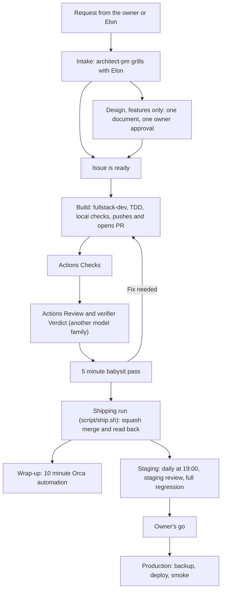

# Agent team reference

Long reference moved out of the root [README](../../README.md). Read it when you need the full role list, the project file map, the per stage command table, the fleet and load distribution rules, the full tool reference, or the skill sharing rules.


## Team guideline

### Goal

An agent team that follows the [Matt Pocock](https://github.com/mattpocock/skills) and [pstack](https://github.com/cursor/plugins/tree/main/pstack) skills and their design, in Orca ADE. A unit goes from ready to merged with no agent relaying a message and no human in the loop. Main reaches staging every day by itself. Production needs green swarm live lanes and the user's go.

### Principles

* Use Orca, pstack and Matt Pocock skills as they are. Customize only when we must, and record why.
* Improve what exists before adding anything. rule table and scripts must not grow in total.
* Each role takes the shortest path that still reaches the targets.
* When speed and quality conflict, quality wins for money, sign-in, database schema and hooks. Everything else takes the fast lane, and daily staging is the second line of defence.
* State lives only in GitHub and Orca. After a restart the team carries on from there.

### Targets

| Measure | Target |
| --- | --- |
| Start to merge, median | 60 minutes or less |
| Checks fail on first pass | 15% or less |
| Reopened or hotfix | 2% or less |
| P0 reaching production | 0 per month |
| Ready to worker start | 15 minutes |
| Build | 40 minutes |
| Checks | 10 minutes |
| Review | 10 minutes |
| Daily staging tests | 15 minutes |
| `heavy-gate` wait, median | 2 minutes or less |
| Worktrees on a host | Running workers plus a fixed list |

Missing data reads as unknown, never zero.

### Lifecycle

Each step is one run that does one job and ends. It never waits on a person or another agent. The next run reads GitHub.



| Step | Starts when | Who | Done when |
| --- | --- | --- | --- |
| Intake | A request arrives | architect-pm with the coordinator. Sales joins for UI or wording, support for support matters | Issue is ready, or closed as a duplicate |
| Design | Intake says it is a feature | Same people, with `capture-intent`, grill, spec and units | One document, one owner approval |
| Build | The 5 minute run finds a ready issue that passes the gates | fullstack-dev | Touched checks green locally, PR open and pushed once |
| Actions Checks | Push to a PR | GitHub Actions | Required checks pass (`head-checks` on app repos) |
| Actions Review | Actions Checks pass | `script/pr-review.sh` in GitHub Actions, read only | Bot review comment and `review` status posted |
| Verifier Verdict | Actions Checks pass | `qa-sdet` (another model family, runs parent against head as a user would) | `Verdict: PASS` or `PASS+NOTES` posted via `script/post-verdict.sh` |
| Babysit | 5 minute babysit pass on each open PR in `check` mode | `fleet-watch.py` | Starts one verifier when head-checks passed and the head has no Verdict. The existing fix worker and a Shipping run still cover a failing head and a passing Verdict |
| Shipping run | Checks pass and verifier Verdict matches head `git patch-id` | `script/ship.sh` | Squash merge (`gh pr merge --squash`) and PR read back as merged |
| Worktree cleanup | Every 10 minutes on each host | Orca automation (`script/wrap-up.sh`) | Finished worktrees, terminals and merged branches read back as gone |
| Staging and review | Daily at 19:00 Taiwan time | `release-manager`, then `qa-sdet` and full regression | Latest trunk deployed, swarm live lanes and regression green (or issue opened) |
| Production | User's go | `release-manager` | Backup, deploy and smoke pass, or code rolls back |

**Babysit.** Every 5 minutes fleet-watch looks at each open PR once and puts it in one group.

* Ready: checks are green and a verifier PASS covers this head. It starts a Shipping run.
* Missing Verdict: head-checks succeeded and this head has no Verdict. It starts one verifier (`qa-sdet` from `usage-gate.py pick`, a different agent and model from the builder) once per head.
* Needs a fix: a conflict with trunk, an unresolved review thread, a review FAIL, a failed head-checks result, or a red check on a file the PR changed. The existing `classify_open_pr` rework start in `issue_scan` starts one fresh fix worker, which fixes, pushes once and ends. Babysit does not start a second one. One PR never has two fix workers at once.
* A pull request that touches an owner-only path is reported to the coordinator and not dispatched. Drafts are skipped. At most two verifier dispatches run per pass. A new push re-arms that head.
* Anything else waits for the next pass.

**Shipping run.** One run of `script/ship.sh` handles one PR. It merges only when all of these hold:

* The PR is open and mergeable, and every check passed.
* The newest Verdict is PASS or PASS+NOTES, from a real verifier who is not the author.
* The Verdict covers this head, or a rebase of it with the same patch id.
* Changes to protected paths carry the user's approval.

It squash merges, reads the PR back as merged and ends. If any condition fails, it prints one line saying why and merges nothing.

**Who can send a request.** The user and the coordinator. Sales and support send requests to the coordinator, and the coordinator gets the user's approval before passing one to architect-pm.

**Start rule.** An issue starts when it has `ready-for-agent`, evidence and predicate and no blocker, and the usage and load gates pass. `P0` and `P1` go first, then first in, first out. A worker starts only from a complete brief: `Refs` to the issue, evidence and predicate, out of scope, verify and finish. The issue scan takes the newest Agent Brief comment (else the issue body) and adds `Refs`, verify and finish itself. `script/brief-lint.sh` checks the brief at every start (Verify must call `script/checks-local.sh`, which runs the Checks workflow for the changed files), and an issue that fails gets `needs-triage` instead of a worker. A change to the brief goes to the issue, never in a message after the worker is done.

**Failure.** A worker with no progress for 30 minutes restarts once. The same error fixed 3 times stops the work. Review sends a PR back at most 2 times. Past any limit a label goes to the coordinator.

**Worktree cleanup.** A finished worker loses its terminal and worktree. A merged or closed PR loses its branches and anything left. Work that exists nowhere else is kept and listed for the coordinator.

**Deploy safety.** Schema changes stay backward compatible. Production always backs up first, and a failed backup stops the deploy. If smoke fails, code rolls back by itself, and the database waits for the user.

### Roles

| Role | Job |
| --- | --- |
| User | Decides the items listed under User decisions |
| The coordinator | The user's window and only contact. Off the main line: the lifecycle runs without it. Answers "what now" and "recap", handles exceptions, sets priorities weekly |
| `architect-pm` | Intake, the design document, the weekly list, full audits |
| `fullstack-dev` | Builds one unit with tests by TDD |
| `qa-sdet` | Verifier Verdict, Playwright runs and the swarm live lanes |
| `release-manager` | Staging on schedule, production on the user's go |
| `secops-finops` | Its check is part of Strong review. Weekly reconciliation |
| `sales-marketing` | Joins the grill for UI and wording. Sends requests to the coordinator |
| `support-csm` | Joins the grill for support matters. Sends requests to the coordinator. Replies go out only after the owner approves |

### Team files

The team docs live once, in `~/dotfiles/templates/agent-team/`. Role files and skills read them there by path, and no project keeps a copy.

A project's `docs/agents/` holds only five files, because shared skills, scripts and hooks read them by a fixed path:

* `issue-tracker.md`, `triage-labels.md`, `domain.md`: read by the Matt Pocock skills and `init-agent-project.sh`.
* `team-facts.md`: the project's own team facts, such as hosts, lanes, times and its differences from `team.md`.
* `deploy-facts.md`: deploy targets and production hosts, read by the deploy skill.

Anything else in a project's `docs/agents/` is a special case that needs the user's approval, recorded in an ADR. Area notes go in `docs/<area>/`, history stays in git and GitHub, and learnings go to auto memory.

### User decisions

New features and pages, prices and money rules, production go, irreversible data changes, budget and legal commitments, paid usage overage, the weekly update PRs, and role file and hook changes. Nothing else interrupts the user.

### Review

A PR owner never reviews its own PR. Review has two layers after Actions Checks pass: the read only bot review in Actions (`script/pr-review.sh`) and the verifier Verdict (`qa-sdet` from another model family running the change as a user would, parent against head, posted via `script/post-verdict.sh`). Review checks the diff against `## Scope` and answers three questions: does the diff meet each acceptance line, is there a real bug, would the new test go red without the fix. The first round lists every finding; later rounds check only earlier points plus the new diff. Style is never a FAIL. A flake reruns the job once, never an empty commit.

Standard depth is one read. Strong depth adds a stronger model and the security check for money, sign-in, schema, hooks and workflows. A script picks the depth from the file list. Changes only to docs and changelog pass with no agent.

### Team tools

These are the only team tools we keep or build. Full contracts live in each project's process spec.

| Tool | Job | Runs |
| --- | --- | --- |
| Orca automation | Starts every scheduled script. A script only job uses a precheck, so it spends no AI quota | On schedule |
| [`fleet-watch.py`](../../script/fleet-watch.py) | The 5 minute run: copies usage readings, reruns failed workflows once, finds stuck workers, checks backups, starts ready issues, runs the babysit pass | Every 5 minutes on the coordinator |
| [`usage-gate.py`](../../script/usage-gate.py) | Blocks a worker start at 95% of a weekly limit or with no fresh reading. Paid overage needs the user's approval with an amount and an expiry | Every worker start |
| [`heavy-gate.py`](../../script/heavy-gate.py) | Holds Playwright and production builds on each host; type checks use measure mode with no slot | Every Playwright run, build and full `tsc` |
| `worker-startup` | Brings a host and worktree up to date, then starts the worker. A host that cannot be fixed takes no work | Daily, and before each worker |
| [`head-checks.sh`](../../script/head-checks.sh) | Runs a repository's checks on a trial merge of one head with trunk | Every PR push |
| Review and Verdict | Actions Review (`script/pr-review.sh`) and verifier Verdict ([`post-verdict.sh`](../../script/post-verdict.sh)) | After Checks pass |
| [`ship.sh`](../../script/ship.sh) | Shipping run: checks `git patch-id` against the verifier Verdict, squash merges and reads the PR back as merged | When Checks and Verdict pass |
| [`wrap-up.sh`](../../script/wrap-up.sh) | Clears finished work. Never deletes the last copy. Add `--apply` to run it by hand | Every 10 minutes on every host |
| `/deploy` | Moves a commit to staging or production | Daily, or on the user's go |
| pstack `swarm` live lanes | Smoke, tests for what changed, changed pages on phone size. Every page weekly | After each staging deploy |
| Test selection | Compares with the last green staging commit and follows real imports | Every swarm live lanes run |
| Weekly update | Matt Pocock and pstack upstream, bun and Node. Three tested PRs, a skill-impact draft on the skill PR branches, and report-only software lines in the stdout summary. Merged only on the user's yes | Weekly |
| [`team-audit.sh`](../../script/team-audit.sh) | Checks team files and reports the target numbers | Weekly one line result, full audit on the user's word |
| `/elon status` | "what now": waiting on the user, running, problems. "recap": merged, deployed, problems and numbers | Only on request |
| Agent state backup | Private repository with memory, schedules and host config, used to rebuild the coordinator | Every 10 minutes |

Project hooks stay small: a command guard for production, secrets and destructive commands, the three strike stop and the worker turn limit.

## Agent team template

Use `script/agent-team.sh` for machine setup (`machine`), new projects (`project`) and drift checks (`check`). See [Agent team setup](#agent-team-setup) below for commands and user steps.

The team files give agents their jobs, working rules and repeatable steps. The coordinator is the user's window and only contact, off the main line: he sets priorities weekly, handles `needs-elon` exceptions, dispatches ready issues within the usage and load gates, and contacts the user only on user decisions. See [Agent team architecture](agent-team-architecture.md) for the full design.

`script/adopt-agent-team.sh [--project-name <name>] <dir>` installs from [templates/agent-team](../../templates/agent-team/): roles, generated team skills, facts file skeletons, role reference docs, settings, hooks, model routing and a Token budget block for `AGENTS.md`. Review the project copies and fill in their facts before using the team.

Role instructions live at `<project>/.claude/agents/<role>.md`. Give workers their role file path in the task prompt (using the main checkout's absolute path so a branch worktree never reads a stale copy), including workers on other providers. Every role edit requires human review and an `Owner-approved: <owner> <date> (<where approved>)` commit trailer.

| Role | Owns |
| --- | --- |
| `elon` | User's window and only contact, weekly priorities, `needs-elon` exceptions, ready issue dispatch, and user decisions. |
| `architect-pm` | Intake, one design document per feature (intent, spec and units), issue triage, the weekly non-blocker list and full `/team-audit` runs. |
| `fullstack-dev` | Features and fixes built with tests first by TDD (Cursor `grok-4.7-xhigh` first, then Claude when quota is out), running touched checks locally before pushing once and opening its PR. |
| `qa-sdet` | Cross-family verifier Verdict (`script/post-verdict.sh`, running parent against head as a user would), Playwright proving runs and the daily/weekly pstack `swarm` live lanes. |
| `release-manager` | Daily 19:00 Taiwan time staging deploy, production deploy on the user's explicit go, release evidence and rollback plans. |
| `sales-marketing` | Self-serve acquisition, positioning, conversion experiments, weekly metrics (MRR, LTV, CAC, churn) and the pre-build grill for new UI pages and wording. Delegates market research and merchant lookups to a Gemini worker on Antigravity with source URLs. |
| `secops-finops` | Security, auth, tenant isolation, money PR reviews (part of Strong review and the money pre-build grill) and weekly financial reconciliation. |
| `support-csm` | Customer ticket triage, reply drafts (sent only after owner approval), recurring pain points and support grill input. |

The adoption script installs every role in the template, including support.

Team skills come from [templates/agent-team/.agents/skills](../../templates/agent-team/.agents/skills/): `elon` is the entry point, `ceo` is its alias, `deploy` holds the release gates, `grill-backlog` lists owner decisions and asks them one at a time, `team-audit` checks team files and metrics, and `poteto-mode` (with `ORCA-ADAPTER.md`, `ketchup`, `recall`, `show-me-your-work`, `correct`, `unslop` and the `principle-*` skills) supplies the vendored pstack playbooks and decision cues. `script/agent-team.sh project` generates project `.agents/skills/` copies with links from `.claude/skills/` and `.cursor/skills/`. Edit the template source and rerun it; `script/agent-team.sh check` fails on drift. Do not edit generated copies.

Team skills add project policy and call Orca and Matt Pocock skills for shared procedures. See [Skills inventory](skills-inventory.md) for the three-tier layout and upstream sync rules.

Other project files tell the team how this repo works:

| File | What to set or read |
| --- | --- |
| `.claude/model-routing.md` | Provider and model choices, worker launch rules, fail-closed usage gate and publication/merge authority. |
| `.claude/settings.json`, `.claude/hooks/` | Claude session setup, Bash safeguards (`guard-bash.py`), fail-closed usage gate (`usage-gate-hook.py`), repeated test failure limits (`strikes.py`) and turn budget (`worker-budget.py`). |
| `docs/agents/team.md` | Team roles, 2026-11-06 process, human approval for role changes, orchestration, the verification rule and Opening a PR, handoffs, Bug fix, urgent (fast mode), rules and gated actions. |
| `docs/agents/team-facts.md` | Repository, check commands, review rules and project shortcuts. |
| `docs/agents/deploy-facts.md` | Components, hosts, stage commands, production approval and rollback steps. |
| `docs/agents/coordinator-operations.md`, `elon-dispatch.md`, `engineering-integration.md` | Coordinator wake loop, failover, fleet placement, review tiers and merge rules. |
| `docs/agents/architect-pm-work.md`, `qa-sdet-execution.md`, `release-manager-work.md` | Role-specific work references loaded on demand to keep `.claude/agents/*.md` under the 800-word budget. |
| `docs/agents/issue-tracker.md` | Where specs and units go and how to read or update them (including sub-issues and native blocking dependencies). |
| `docs/agents/triage-labels.md` | The project's issue labels and what each means. |
| `docs/agents/domain.md` | Where agents read domain terms (`CONTEXT.md`) and design decisions (`docs/adr/`). |

Adoption creates `team.md`, `team-facts.md`, `deploy-facts.md` and the role reference docs. Create the tracker, label and domain files with `~/dotfiles/script/init-agent-project.sh --labels <dir>` (automatically run by `script/agent-team.sh project`). Configure `docs/agents/daily-run.md` in the project before turning on the `daily-program-1900` automation. Decisions belong in `docs/adr/`.

Use slash commands below in Claude Code, Cursor and Antigravity. A worker prompt can instead name the skill's `SKILL.md` path and ask it to follow the file.

| Stage | What happens | Skill or command | Example prompt |
| --- | --- | --- | --- |
| Adopt the team | Install the files, then fill in project facts and tracker setup. | `script/agent-team.sh project <dir> --project-name <name>` | Adopt the team into `~/projects/acme` and show me the facts I need to fill in. |
| Start a session | Talk to the coordinator, who routes the work and runs `recall` and `ketchup`. | `/elon` or `/ceo` | `/elon Help me choose the next objective.` |
| Intake and Design | For a new feature, produce one design document (intent, spec and units) for one user approval. Attach phone screenshots for any new UI page. | `/capture-intent`, `/write-spec`, `/to-spec`, `/to-tickets` | `/capture-intent New users cannot tell whether setup is complete.` |
| Pre-build grill | Run a multi-role grill only for money (`secops-finops`, `architect-pm`, the coordinator) or new UI pages (`sales-marketing`, the coordinator); owner approves before build. The coordinator decides all other work on the issue. | `/grill-with-docs`, `/grilling`, `/grill-backlog` | `/grill-backlog Run the pre-build grill on the pending money and UI issues.` |
| Dispatch and build | The coordinator assigns ready units (`Acceptance criteria`, `Requirement owner`, `Deleted`) under the usage and host gates; workers build by TDD on touched tests in child worktrees and report `worker_done`. | `/elon <objective>` (pstack Orchestrate), `script/worker-startup.sh`, `/tdd` | `/elon Deliver the ready setup tickets.` |
| Checks and review | Actions `Checks` (`head-checks.sh`) run on push; Actions `Review` (`script/pr-review.sh`) runs the read only bot review, and a cross-family `qa-sdet` verifier runs parent against head as a user would and posts the `Verdict` via `script/post-verdict.sh`. | `script/head-checks.sh`, `script/pr-review.sh`, `script/post-verdict.sh`, `/code-review` | `/code-review Check this branch against main and its ticket.` |
| Babysit, ship and worktree cleanup | The 5 minute pass (`fleet-watch.py`) starts one verifier when head-checks passed and the head has no Verdict. The existing fix worker and a Shipping run (`script/ship.sh`) still cover a failing head and a passing Verdict; `wrap-up.sh` runs every 10 minutes. | `script/ship.sh`, `script/wrap-up.sh`, pstack `worktree-cleanup` | Run a Shipping pass on the verified PR and wrap up finished worktrees. |
| Deploy and swarm live lanes | Staging deploys daily at 19:00 Taiwan time, followed by the pstack `swarm` live lanes and full regression; a green review leads to a one-line summary and same-day user go for production. | `/deploy local`, `/deploy staging`, pstack `swarm`, `/deploy production` | `/deploy staging Promote main and start the daily staging review.` |
| Status | Get company status (**Now**, **Needs user**, **Running**) or a recap. The daily program starts from the `daily-program-1900` automation, not a command. | `/elon status` | `/elon status Show Now, Needs owner and Running.` |
| Audit and weekly update | Orca runs `team-audit.sh` and `script/team-audit-metrics.ts` weekly for one line; `architect-pm` runs `/team-audit` on the user's word; `weekly-update.sh` opens three upstream PRs for user review. | `/team-audit`, `script/weekly-update.sh` | `/team-audit Check this repo's team files, metrics and observations.` |
| Support | The coordinator routes fixes and `support-csm` drafts the customer reply in the customer's language; the user approves before sending or closing. | Ask the coordinator to assign `support-csm` | The coordinator, resolve this support ticket and bring me the reply draft for approval. |

## Fleet and load distribution

The team runs across a fleet of Macs paired in Orca ADE (`orca environment list`) and coordinated from a single active coordinator host named in `agent-state/coordinator.conf`.

1. **Coordinator and host sync:** `script/elon-startup.sh` checks that the current machine is the named coordinator, `agent-state` is fresh (`.sync-ok` under 30 minutes), and every fleet host has fast-forwarded `main` checkouts (`script/fleet-pull.sh`) and synced secrets (`script/secrets-sync.sh`). Backup hosts watch the coordinator via `script/fleet-watch.py` (`coordinator_watch`) and take over only when the user runs `script/take-over-coordinator.sh --yes`.
2. **Host placement order (`~/.claude/state/fleet-load.sh`):**
   - **Primary code host (also hosts the coordinator):** first choice for code, test and review while 1-minute load < 12.
   - **First overflow host:** next choice while 1-minute load < 8.
   - **Second overflow host:** next choice while 1-minute load < 12.
   - **Browser and secrets host:** always used for browser work, secrets and main-checkout operations.
   - **Release-manager host:** runs only on a host named in the project's `docs/agents/deploy-facts.md`.
   - **Database and heavy host:** runs the dev database and remote Playwright or `head-checks.sh` jobs via `script/remote-heavy.sh`; never runs interactive agent workers.
3. **Worker admission and load targets (user 2026-11-04):** admit a new worker on a host when `(1-minute load / CPU cores) < 0.7` and `free memory >= 4 GB`, within the host's worker cap (`host_caps`). Caps are a ceiling, never a target: fill an idle host up to its cap before any host with queued work waits, and keep each active host between `0.4` and `0.7` load per core. Count PR owners, verifiers, child dispatches and finished committers still holding a pending-push slot.
4. **Per-host heavy job admission (`script/heavy-gate.sh` and `script/heavy-gate.py`):** Playwright and production builds are heavy: at most 2 per host (unless calibrated higher), waiting until 1-minute load is below the host limit (default 12) and free RAM is at least 20%. They use `--weight 2`; `HEAVY_GATE_CLASS=long` leaves 1 slot free. Full `tsc` uses `--measure` (no slot, logs metrics for the user trial week). Unit tests and lint skip the gate.
5. **Provider quota distribution (`script/usage-gate.py` and `script/usage-gate-hook.py`):** every worker launch checks real weekly quota across Claude, Cursor and Antigravity, reserving 2% per running worker on that provider and refusing dispatch at the 95% weekly ceiling (exit 3) or when readings are stale beyond 5 minutes and cannot refresh (exit 4).

See [Agent team architecture](agent-team-architecture.md) and [Coordinator operations](coordinator-operations.md) for full details.

## Tools

All team tools live under `script/`, `.agents/skills/orca-team/`, and `bin/`.

### Setup, adoption and skill sync

| Tool | Purpose |
| --- | --- |
| `script/agent-team.sh` | Single entry point: `machine` setup, `project` adoption (also refreshes generated team skills), `sync`, read-only `check` for drift, and `all`. |
| `script/adopt-agent-team.sh` | Copies the agent team template (`.claude/agents/`, hooks, `model-routing.md`, `team.md`, facts skeletons) into a project and syncs team skills. |
| `script/init-agent-project.sh` | Seeds `docs/agents/{issue-tracker,triage-labels,domain}.md`, appends `## Agent skills` to `AGENTS.md`, and with `--labels` creates the five triage labels on GitHub. |
| `script/agent-project-autoinit.sh` | Claude Code `SessionStart` hook that auto-runs `init-agent-project.sh --labels` for unseeded `mingster/*` repos. |
| `script/sync-mattpocock-skills.sh` | Refreshes the 22 vendored Matt Pocock skills from upstream and reapplies `CONTEXT.md` naming and `.mattpocock-local.patch`. |
| `script/check-skill-collisions.sh` | Checks for project skills that shadow shared or Orca-bundled skills, broken symlinks, or missing `SKILL.md` files. |
| `script/bootstrap-asdf-tools.sh` | Installs and pins `python` and `nodejs` from `.tool-versions` via `asdf`. |
| `script/bun-pin-check.sh` | Warns when a local or remote host's `bun` version is older than the repo's `package.json` pin (`packageManager` or `engines.bun`). |
| `script/switch-login-shell-zsh.sh` | Links zsh dotfiles and switches the host's login shell to `zsh` so remote Orca probes and hooks share one PATH. |
| `script/agent-settings-check.py` | Read-only coverage check classifying local agent settings against public templates and `AGENT_PRIVATE_BACKUP_MANIFEST`. |
| `script/backup-claude-desktop.sh` | Copies sanitized live Claude Desktop settings into `init/claude_desktop_config.json`. |
| `script/contribute-to-agents.sh` | Appends a dated reusable lesson to `.agents/claude/notes/<topic>.md`. |

### Coordinator, fleet and state sync

| Tool | Purpose |
| --- | --- |
| `script/elon-startup.sh` | Coordinator session-start check: verifies `coordinator.conf` and `.sync-ok` freshness in `agent-state`, then runs `fleet-pull.sh` and reports host status. |
| `script/new-coordinator.sh` | Bootstraps a new Mac as the coordinator from `agent-state` (Homebrew bundle, repo clones, state restore, LaunchAgents, Orca data restore and health checks). |
| `script/take-over-coordinator.sh` | Manual coordinator failover and handback using `coordinator.conf` in `agent-state` (`--dry-run` first, `--yes` to execute). |
| `script/orca-reply.sh` | Sends `orca orchestration reply` to a worker and nudges its terminal so an idle session wakes up immediately. |
| `script/fleet-pull.sh` | Fast-forwards clean `main` checkouts across configured fleet hosts (for hosts in `agent_hosts`, resets configured repositories to `origin/main` and cleans untracked files while keeping ignored files and fast-forwarding `~/agent-state` only) and triggers `secrets-sync.sh`. |
| `script/fleet-watch.py` | Independent 5-minute watchdog: monitors inbox waiters, host caps, lead panes, stalled workers (`worker_stall`), backup freshness (`backup`), failed PR checks (`pr_watch`), `heavy_gate` wait medians, `wrap_up` freshness, `coordinator_watch` on backup hosts, and opt-in `issue_scan` auto-dispatch. |
| `script/fleet-workers.py` | Lists active Orca workers and dispatches across local and remote fleet environments. |
| `script/count-agents.sh` | Counts active coding agent CLI processes (`claude`, `agent`/`cursor-agent`, `agy`, `gemini`) from a process snapshot. |
| `script/secrets-pack.sh` | Packs local secrets into an AES-256 encrypted `hdiutil` disk image for transfer between Macs. |
| `script/secrets-unpack.sh` | Unpacks an AES-256 secrets disk image onto a host. |
| `script/secrets-sync.sh` | Syncs the shared secrets directory across reachable fleet hosts. |

### Worker launch, usage gate and heavy gate

| Tool | Purpose |
| --- | --- |
| `script/worker-startup.sh` | Unified worker launcher and daily `--host-check`: aligns `~/dotfiles`, Orca presets, repo `main`, Node `.tool-versions` via `asdf` and Bun pins, checks `usage-gate.py`, and delegates to the provider starter. |
| `script/start-remote-worker.sh` | Checks `usage-gate.py`, probes the remote CLI in an Orca terminal, refreshes remote `~/dotfiles` and `~/.orca/presets.json`, and calls `orca orchestration worker-start --on`. |
| `script/start-cursor-worker.sh` | Creates a local or remote `--on` worktree, writes `.workspace-trusted` via Python 3 in an Orca terminal, checks `usage-gate.py`, and starts a Cursor worker. |
| `script/worktree-setup.sh` | Orca worktree setup hook: fetches and fast-forwards `origin/main` and runs `bun install --frozen-lockfile` when `node_modules` is missing. |
| `script/usage-gate.py` | Reads real Claude, Cursor and Antigravity quota, publishes readings to runner hosts (`--publish`), checks the 95% weekly ceiling (`check`), and ranks candidates (`pick`). |
| `script/usage-gate-hook.py` | Fail-closed Claude `PreToolUse` hook blocking any `worker-start` that bypasses `usage-gate.py`, lacks fresh readings, or calls `--on` directly. |
| `script/heavy-gate.sh` | Shell wrapper around `heavy-gate.py` for Playwright and production builds (`--weight 2`), plus `--measure` type checks without a slot. |
| `script/heavy-gate.py` | Enforces per-host slot limits, load ceiling, free memory floor, and `HEAVY_GATE_CLASS=long` reservation; logs slot waits and measure runs. |
| `script/hw-probe.sh` | Probes host CPU cores and RAM and calibrates per-host `heavy-gate` slots and load limits into `~/.config/heavy-gate/slots.conf`. |
| `script/remote-heavy.sh` | Syncs a commit to a remote fleet host, runs a heavy command there under that host's `heavy-gate.sh`, and copies artifacts back. |
| `script/run-scoped-tests.py` | Selects and runs unit tests scoped to changed files and their direct importers. |

### Checks, review and merge

| Tool | Purpose |
| --- | --- |
| `script/pr-review.sh` | Runs the read only cold PR review on the self hosted `Review` runner after GitHub Actions `Checks` pass (replacing `script/on-worker-done.sh`; uses `script/review-prompt.sh`, `script/review-prompt.txt`, `script/review-model.sh`, `script/review-run.sh`, `script/pr-review-author-family.py`). |
| `script/coordinator-publication.sh` | Pushes an explicit engineering branch (`--branch <branch> --worktree <path>`) and opens or updates its PR after validating `Closes #<n>`, `## Verification` bullets, and zero `.env` secrets. |
| `script/head-checks.sh` | Runs a repo's `.agents/head-checks.conf` checklist once on a trial merge of the PR head with `main` in a throwaway worktree; only Playwright and build steps wait on `heavy-gate.sh`. |
| `script/dotfiles-sync.sh` | Fast-forwards `~/dotfiles` when it is on main, clean and behind, with the rule `session-sync.sh` uses; a dirty, diverged or offline checkout prints one line and the job still runs. A project workflow that runs `$HOME/dotfiles/script/head-checks.sh` (or any other dotfiles script) on a self-hosted runner calls `bash "$HOME/dotfiles/script/dotfiles-sync.sh"` as its first step. |
| `script/head-checks-tsc.sh` | TypeScript check helper invoked by `head-checks.sh` profiles. |
| `script/post-verdict.sh` | Validates and posts a canonical `Verdict: PASS|PASS+NOTES|FAIL head=<sha> verifier=<id> author=<id>` comment and `review` status on a PR, refusing self-review. |
| `script/ship.sh` | Shipping run: verifies required checks and matching `git patch-id` Verdict, merges with `gh pr merge --squash`, and reads the PR back as `MERGED`. |

### Cleanup, audits and weekly maintenance

| Tool | Purpose |
| --- | --- |
| `script/wrap-up.sh` | Previews and prunes finished worktrees, merged branches (protecting `archive/*` tags), ended Orca terminals/panes (25s budget), stale temp browsers, Chrome clones and agent temp files (`--fleet`, `--scheduled`). |
| `script/worktree-idle.py` | Exits 0 only when `orca terminal list` positively confirms a worktree has zero active terminals. |
| `script/team-audit.sh` | Six deterministic checks: skill sync (`agent-team.sh check` per project), 800-word role budget, banned wording, skills (frontmatter, lock, helpers, role `skills:` names), ready-for-agent label conflicts, and `Owner-approved:` trailers after a baseline sha. `--log` writes the observation TSV; `--report` adds the metrics. |
| `script/team-audit-metrics.ts` | `bun script/team-audit-metrics.ts --repo <owner/name> [--days <n>] [--json] [--times <stages.tsv>]` prints the weekly delivery metrics from GitHub PRs and issues (`median_ticket_start_to_merge_minutes`, `first_pass_checks_fail_rate`, `p0_filed_this_month`, `p1_filed_this_month`, `reopened_or_hotfix_rate`) and, with `--times`, the Orca stage medians. `--fixture <data.json>` reads a file instead of GitHub. No project keeps its own copy. |
| `script/weekly-update.sh` | Weekly maintenance runner that updates Matt Pocock skills, pstack template skills, Bun and Node LTS across three tested PRs and one user summary. |
| `script/prepend-recent-change.ts` | Prepends dated change summaries to project changelog or recent-change files. |
| `script/shellcheck-dotfiles.sh` | Runs `shellcheck --severity=error` on the repository's shell entrypoints. |

### Orca-team pane and watch helpers (`.agents/skills/orca-team/`)

| Tool | Purpose |
| --- | --- |
| `worker-start-check.sh` | Runs `usage-gate.py check` for the chosen `--agent` and `--model`, then calls `orca orchestration worker-start`. |
| `worker-watch.sh` | Polls active Orca workers and detects stalled sessions so the coordinator can nudge, retry or respawn them. |
| `worker-panes.sh`, `worker-pane.sh` | Opens and colors supervised worker panes in Orca by role (`role-colors.tsv`). |
| `worker-pane-close.sh` | Closes ended worker panes/terminals (`--ended` or `--release <dispatch_id>`) and kills leftover process groups. |
| `worker-pane-retry.sh` | Retries or respawns a failed or stalled worker pane cleanly. |

## Skills

Reusable skills live in `.agents/skills/<name>/` and are visible to Claude Code, Cursor and Antigravity through individual links in `~/.agents/skills` and `~/.claude/skills` (also read by Cursor), and the Antigravity `skills.json`. A project skill with the same name as a central one silently wins, so keep the two sets apart:

| Kind | Lives in |
| --- | --- |
| Reusable across projects | here, `.agents/skills/<name>/`, and nowhere else |
| Project specific | `<project>/.agents/skills/<name>/`, with symlinks from `<project>/.claude/skills/` and `<project>/.cursor/skills/` |

Run `bash script/setup-agent-skills.sh` to migrate legacy tree links to real directories. It retains tool-installed skills and their lock data, leaves the old source intact, links only tracked dotfiles skills, runs `orca skills install --all` when `orca` is on `PATH`, and prints its actions. Existing tool folders and foreign links are preserved, including same-name conflicts. `DOTFILES_SKIP_SYSTEM_SETUP=1 bash install.sh` also performs this migration without installing software. The skill inventory requires a Git checkout.

Run `script/check-skill-collisions.sh` to find a project skill that shadows a central or Orca-bundled one, a broken symlink, or a missing `SKILL.md`. MCP secrets go in `~/.claude/settings.local.json` (gitignored). Paths reference: [AGENTS.md](../../AGENTS.md).

## Context, notes and backups

Project instructions (`AGENTS.md`) load always. Short cross-project rules live in `~/.claude/notes/` (`.agents/claude/notes/`) and the Obsidian vault holds deep docs. Add a lesson from any project:

```bash
~/dotfiles/script/contribute-to-agents.sh nextjs "Nested route-group layouts cause dev 404s"
```

```bash
bash script/backup-claude-desktop.sh   # Claude Desktop settings into init/
```

## Agent team setup

Use `script/agent-team.sh` as the entry point for machine setup and project adoption.
Run `script/agent-team.sh --help` for the supported commands.

```bash
script/agent-team.sh machine
script/agent-team.sh project /path/to/project --project-name acme
script/agent-team.sh check /path/to/project
script/agent-team.sh all /path/to/project
```

Machine setup configures Claude Code, Cursor, Antigravity, Orca and shared
skill links. Verification reports missing commands and user login steps without
reading credential files. Missing user prerequisites are warnings; a failed setup
script is an error. Use `--dry-run` to preview machine setup without running it.

Missing provider CLIs are installed once using `install_claude.sh`, the official
Cursor and Antigravity installers. Installer references:
[Claude Code](https://code.claude.com/docs/en/setup),
[Cursor](https://cursor.com/docs/cli/installation) and
[Antigravity](https://antigravity.google/docs/cli/install/).
Existing differing configuration files are moved to `<file>.bak.<date>` before
replacement. `setup-orca.sh` links `~/.orca/presets.json` to `~/dotfiles/.orca/presets.json`
after backing up any differing file. Usage gate (`usage-gate-hook.py`) and worker budget
(`worker-budget.py`) hooks are composed into Claude Code, Cursor and Antigravity hook
files via `setup-agent-hooks.sh`. Logins and credentials are never migrated or inspected.
Orca installation and sign in remain user steps when its CLI is missing.

`project` adopts a project: it installs the team files, generated team skills and tracker seeds, and
`team-audit.sh` then reports findings. The user or architect must review
`docs/agents/team.md` and fill in
`docs/agents/team-facts.md`, `docs/agents/deploy-facts.md` and
`docs/agents/domain.md`, then establish the project's domain context and deployment
commands. Label creation requires GitHub access. Customized role files are
preserved and reported for manual reconciliation. It also refreshes the Token budget, Compact
instructions and User context commands sections in `AGENTS.md`, keeping other project
instructions. Product facts, domain context, ADRs and intents
stay project owned; never put product facts in generated team skills. `check` is read only and
exits non zero on drift. `all` configures the machine first, then runs `project`; `all --dry-run`
previews both stages.

The commands use the vendored skills already in dotfiles. Updating that snapshot
from upstream is a separate maintainer operation through
`script/weekly-update.sh` (which refreshes Matt Pocock skills, pstack template skills,
Bun and Node LTS across three tested PRs and one summary for the user's go) or
`script/sync-mattpocock-skills.sh`; project setup never refreshes upstream or
changes the dotfiles checkout. No command commits or pushes the target project.

### Fleet readiness

After `install.sh` finishes on a host, add it to the private `~/agent-state` repository and register its scheduled Orca jobs.

Roles live in `~/agent-state/coordinator.conf` with one `coordinator <name>` line for the active coordinator and ordered `backup <name>` lines for backup hosts, where `<name>` matches `hostname -s`. Every host in the fleet keeps a clean `main` checkout of `~/agent-state` and the configured project repositories.

```bash
~/dotfiles/script/fleet-pull.sh
~/dotfiles/script/fleet-toolchain-check.sh
~/dotfiles/script/install-fleet-automations.sh --dry-run --install
~/dotfiles/script/install-fleet-automations.sh --install
~/dotfiles/script/install-fleet-automations.sh --status
```

| Command | Effect |
| --- | --- |
| `script/fleet-pull.sh` | Fast-forward `main` in `~/agent-state` and each configured repository on every host, then run `agent-team.sh machine` from `~/dotfiles` so role files and `session-start.md` follow the template. Prints `ok` with the short commit, or exits non-zero with `fail <host> <repo>` when a checkout is `dirty`, `not on main: detached` (or on another branch), `diverged: not fast-forward`, `behind after pull`, or unreachable |
| `script/fleet-toolchain-check.sh` | Compare each fleet host's CLI versions against the coordinator in `coordinator.conf`, and the coordinator against the latest release (add `--apply` to align `.tool-versions` pins and upgrade supported tools; peers move to the coordinator's claude, bun and Orca, never past it, and each failed step prints `<host> apply: <step> failed: <error>`. Orca is upgraded only on a host with no live claude, codex, agent or agy process, since the upgrade restarts Orca; a busy host prints `<host> apply: orca upgrade skipped, live agents: <names>`. macOS replaces `/Applications/_dev/Orca.app` from the release zip, Arch installs `stably-orca-bin` only when the AUR has the target version) |
| `script/install-fleet-automations.sh --dry-run --install` | Print the planned `orca automations` commands without changing Orca |
| `script/install-fleet-automations.sh --install` | Create or update the six fleet automations on this host (safe to run again) |
| `script/install-fleet-automations.sh --status` | Print enabled or disabled status for each fleet automation on this host |
| `script/worker-startup.sh --host-check` | Verify `~/dotfiles`, Orca presets, repository checkouts and runtime pins before the host takes work |

Each automation runs a shell precheck that exits `1` when done, so Orca starts no agent session and spends no AI quota. Orca caps every precheck at 600 seconds (`wrap-up-scheduled` and `weekly-update` bound their timeouts so each run finishes inside the 600 second cap). When `~/dotfiles` is a symlink on a host, `install-fleet-automations.sh` resolves the canonical path and matches the checkout in Orca by repository ID. Hosts without the Orca app installed (such as a headless host) are skipped with a clear message and exit `0`.

| Automation | Schedule | Enabled where |
| --- | --- | --- |
| `fleet-watch` | `*/5 * * * *` | Coordinator only |
| `fleet-toolchain` | `0 5 * * *` | Coordinator only |
| `wrap-up-scheduled` | `*/10 * * * *` | Every Orca host (skipped on a headless host without the Orca app) |
| `sync-team-skills-drift` | `0 6 * * *` | Created disabled for the user to turn on |
| `team-audit-weekly` | `0 7 * * 1` | Created disabled for the user to turn on |
| `weekly-update` | `0 8 * * 1` | Created disabled for the user to turn on |

Readiness checklist for a fleet host:

* [ ] `hostname -s` is set under `coordinator` or `backup` in `~/agent-state/coordinator.conf` and listed in the fleet pull config.
* [ ] `~/dotfiles/script/fleet-pull.sh` prints `ok` for `~/agent-state` and every configured repository on every host, with no `dirty` or `detached` checkouts.
* [ ] `~/dotfiles/script/fleet-toolchain-check.sh` reports all required CLIs present and aligned with the coordinator.
* [ ] `~/dotfiles/script/install-fleet-automations.sh --status` shows `wrap-up-scheduled` enabled on every Orca host, `fleet-watch` and `fleet-toolchain` enabled on the coordinator only, and `sync-team-skills-drift`, `team-audit-weekly` and `weekly-update` created disabled for the user to turn on (or skips cleanly on a headless host without the Orca app).
* [ ] `~/dotfiles/script/worker-startup.sh --host-check` passes cleanly.

See [Orca automations](orca-automations.md), [Fleet watch](fleet-watch.md) and [Coordinator operations](coordinator-operations.md) for full details.


### Merging through ship.sh

The coordinator runs `script/ship.sh --repo owner/name --pr N` itself, one PR at a time, bottom up
(add `--mechanical` for a pure substitution or deletion, `--verdict-from <owner/dotfiles#N>` for
generated team copies). No merge worker is dispatched.
The script refuses unless the PR is open, mergeable, every required check is SUCCESS and the
newest Verdict is PASS (carried across a rebase by `git patch-id`). It also refuses user
only files (`.claude/hooks/`, `.claude/settings.json`, `bin/owner-approve.sh`, `*.rules`,
and intents that become Accepted). An Accepted intent passes when every commit in the PR that
touches that intent file carries a non-empty `Owner-approved: <owner> <date> (<where approved>)`
trailer, meaning the owner already accepted it in chat; one commit without it refuses the PR.
It squash merges and reads the PR back as `MERGED`.

### Interpreters (asdf)

The root `.tool-versions` pins python and nodejs. Every host runs both through asdf, so
`python3` and `node` resolve the same way everywhere. Scripts keep `#!/usr/bin/env python3`
and never hardcode an interpreter path.

The user runs the bootstrap once per host:

```bash
bash ~/dotfiles/script/bootstrap-asdf-tools.sh
```

It installs asdf if missing, adds the plugins, installs the pinned versions, writes the same
pins into `~/.tool-versions`, and prints the resolved `python3` and `node`. A second run
changes nothing and says so. Pass `--dotfiles <dir>` to read the pins from another checkout.

Tests that set `HOME` to a temp dir source `script/tests/lib/asdf-pin.sh` (python tests import
`asdf_pin.py`) first. It exports the version pins and `ASDF_DATA_DIR`, since asdf looks for its
installs under `$HOME/.asdf`. `script/tests/asdf-pin-coverage.test.sh` fails when a test skips it.
